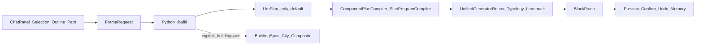

# Formacraft — System Architecture Contract

**Formacraft is a semantic architecture compiler for Minecraft.**

> 核查更新：2026-11-15。新人先读 [开发入口](docs/DEVELOPER_START_HERE.md)。  
> 运行时流程真相：[GENERATION_PIPELINE.md](docs/GENERATION_PIPELINE.md)。  
> 未决债与弃用退出清单：[ARCHITECTURE_AUDIT.md](docs/refactoring/ARCHITECTURE_AUDIT.md)。  
> 本文只写**稳定契约**（分层、唯一主干、不变量、禁止事项）。分批整改日记与易过期示例不放在这里。

---

## 1. Project Overview

Formacraft 是基于 **Fabric（Minecraft 1.21.10）** 的 AI 建筑生成模组：玩家用自然语言 + 空间工具描述意图，系统规划、预览并落地方块修改。

**目标**：把建造从「操作级」提升到「语义级」——AI 规划意图，Java 确定性实现几何与世界写入。

| 层 | 技术 |
|---|---|
| 模组 | Java 21+ / Fabric API / Gradle |
| 规划后端 | Python 3.12+ / FastAPI |

---

## 2. Canonical Pipeline（唯一主干）

**本项目只有一条受支持的「描述 → 建筑」主干：LlmPlan。**  
所有新功能只能加在这条主干上；其余路径为显式兼容（compat），不得扩展为第二条日常主干。

```
ChatPanel / Selection / Outline / Path
  → FormaRequest（默认 outputFormat=llmplan）
  → Python POST /build → generate_llm_plan()
  → LlmPlan（components[] | plan_program | patch）
  → ComponentPlanCompiler / PlanProgramCompiler
  → UnifiedGeneratorRouter（构件 / 类型 / 显式 landmark 执行器）
  → BlockPatch
  → Preview → /forma_confirm → BuildExecutionService
  → Undo / Memory
```



### 路径角色（禁止写成日常二选一）

| 路径 | 触发 | 角色 |
|------|------|------|
| **A. LlmPlan（默认）** | 后端 `kind=llmplan` | 唯一默认规划与预览链 |
| **B. BuildingSpec / City / Composite** | **仅**显式 `outputFormat=buildingspec` 或后端对应 kind | ACTIVE_COMPAT 适配器 |
| **C. Patch 增量** | `LlmPlan.mode=patch` | 仍属 LlmPlan 主干 |

House / Tower / 地标 / 参数化构件可作为**执行器**保留（经 `UnifiedGeneratorRouter` / `GenerationHub.routeStructure`），**禁止**独立规划、预览或确认链。

LlmPlan 预览失败**不再**回退假 BuildingSpec；失败记 `preview_unhandled_no_structure_fallback`（审计 LEGACY-014 已 MIGRATED）。

---

## 3. Hard Invariants（不变量）

1. **AI 永不直接写世界** — LLM 只输出语义 JSON；世界写入只经 `BlockPatch` → 执行器。
2. **单一计划协议** — 默认与新能力使用 `LlmPlan`；BuildingSpec 等仅显式 opt-in。
3. **可预览、可确认、可撤销** — Build 走 `PreviewStorage` + `/forma_confirm`；Patch 走 `PreviewTicket`；历史分 `UndoService` / `PatchHistoryManager`（未合并，见审计）。
4. **质量门** — `BuildQualityReport`：Fatal 拒绝；Error 需 `/forma_confirm force`；详见运行时文档。
5. **Prompt 后端拥有** — `prompt_assembly.py` + `llm_plan_system_prompt.py`；客户端只下发 `userMessage` + 结构化工具字段（`BuildPromptContextEnricher`）。客户端 `PromptAssembler` **已删除**。

---

## 4. Package Layering

目标规则；债务由 `scripts/check_architecture.py` + `config/architecture-debt.json` 冻结。

| 包 | 允许 | 禁止 |
|----|------|------|
| `com.formacraft.common.*` | DTO、算法、网络 payload / codec | `import` server/client；直接碰 `ServerWorld` / UI |
| `com.formacraft.server.*` | 世界写入、权威网络、编排、预览票据 | 依赖 client 渲染 |
| `com.formacraft.client.*` | UI、工具、预览渲染、C2S | 直接改服务端世界 |

跨层只传 common DTO（如 `ToolConstraintSnapshot`、`BlockPatch`、`ApplyResult`）。

**UI**：HUD Panel 超 ~400 行须拆「薄编排 + Section」；参考 `client.ui.panel.capture.*` / `settings.*`。

---

## 5. Core Modules（定位，非教程）

| 职责 | 位置 |
|------|------|
| 模组入口 | `com.formacraft.FormacraftMod` |
| 建造请求分发 | `server.network.BuildRequestProcessor` |
| 编排客户端 | `server.orchestrator.OrchestratorClient` → `POST /build` |
| LlmPlan 预览 | `server.network.LlmPlanPreviewBuilder` |
| 编译 | `server.compiler.ComponentPlanCompiler` / `PlanProgramCompiler` |
| 构件路由 | `server.generation.component.adaptor.UnifiedGeneratorRouter` |
| 整栋门面 | `server.generation.GenerationHub` |
| Patch / 过滤 | `common.patch.*`；服务端 `ServerPatchFilter` / `PatchPreviewService` |
| Python 规划 | `python_backend/app/routes/build.py`、`services/ai_planner.py` |
| Prompt | `services/prompt_assembly.py`、`llm_plan_system_prompt.py` |

子系统细节（Skeleton、Socket、Memory、Tools）见 Tier 2 文档；行为以代码与 [GENERATION_PIPELINE](docs/GENERATION_PIPELINE.md) 为准。

---

## 6. Prohibitions（禁止事项）

- 新增第二条默认 spec / 确认流程，或把 compat 写成与 LlmPlan「日常二选一」。
- 恢复已删的 `BuildingSpecRoutingPolicy`、`requestBuildingSpec`、客户端 `PromptAssembler` 作为现行入口。
- 在 common 中新增对 server/client 或裸 `setBlockState` 的依赖。
- 以完成报告 / 过期 SUMMARY 文档覆盖 Tier 0 契约。
- 暗示再接第三套通用过滤主干（`PatchFilterPipeline` / `ToolPatchFilter` 设计稿已删除；现行过滤只有 `ServerPatchFilter` 与 `BuildConstraints`，共用 `MutationRegionPolicy`，见 WORLD_MUTATION_CONTRACT）。
- 删除仍有消费者的 compat 路径（先更新审计退出清单）。
- 新增「注册后从不渲染」的脚手架：注册表/枚举/接口齐备但无实际调用方的子系统，等同死代码（见 `common/debug/` 的历史教训）。
- 新增「注册后从不调用」的脚手架：实现类被注册表登记，但**接口方法在生产代码中无任何调用点**（见 `server/skeleton/gen/assembler/` 的历史教训）。这类结构靠「零外部引用」扫描抓不到，因为类之间互相引用。
- 新增永远 `visible = false` 的 UI 按钮，或只弹"此功能尚未实现"的存根处理器：永久不可见的 UI = 死代码（见构件捕获面板"智能分析/自动检测"的历史教训）。
- 新增**从任何入口都打不开**的功能簇：整簇类互相引用，逐类看都有"引用者"，实际整簇不可达（见 `BlueprintPanel` 的历史教训）。判据是可达性，不是引用计数。
- 新增**只写不读**的注册表/缓存：某注册表被 `bootstrap` / `register` 填充，却没有任何生产代码去 `get` / `getOrDefault` 它（见 `SemanticPaletteRegistry` 的历史教训）。写入口有调用点 ≠ 读出口有调用点。

---

## 7. PR 自检（防回退）

- [ ] `common.*` 未 import `server.*` / `client.*`
- [ ] 世界写入只经 BlockPatch 执行路径
- [ ] 新能力挂在 LlmPlan 主干；未新增隐式 buildingspec 默认
- [ ] 跨端只传 common DTO
- [ ] Panel > 400 行已拆分；可应用结果已接质量门
- [ ] 活文档未把已删类型当作现行实现（`scripts/check_doc_dead_symbols.py`）
- [ ] 无零消费者顶层类型（`scripts/check_dead_code.py`）
- [ ] 无「声明但从未被调用」的接口方法（`scripts/check_unused_interface_methods.py`）
- [ ] 无从框架入口不可达的顶层类型（`scripts/check_unreachable_types.py`）
- [ ] 若触及兼容入口：已更新 [弃用退出清单](docs/refactoring/ARCHITECTURE_AUDIT.md)

---

## 8. Related Documentation

| 文档 | 职责 |
|------|------|
| [DEVELOPER_START_HERE](docs/DEVELOPER_START_HERE.md) | 10 分钟导航 |
| [GENERATION_PIPELINE](docs/GENERATION_PIPELINE.md) | 现行运行流程与类路径 |
| [GENERATION_AUTHORITY_MAP](docs/architecture/GENERATION_AUTHORITY_MAP.md) | 规划权 / 执行权矩阵 |
| [ARCHITECTURE_AUDIT](docs/refactoring/ARCHITECTURE_AUDIT.md) | 未决债 + 弃用退出清单 |
| [PREVIEW_UNDO_INVARIANTS](docs/PREVIEW_UNDO_INVARIANTS.md) | Preview/Confirm/Undo 双栈冻结（不合并存储） |
| [MIGRATION_LLMPLAN_VS_BUILDINGSPEC](docs/MIGRATION_LLMPLAN_VS_BUILDINGSPEC.md) | 构件 vs 结构**能力对照**（非现行路由指南） |
| [INDEX](docs/INDEX.md) | 文档分层索引 |

手测 golden path 与质量 eval 命令见开发入口与 `python_backend/eval/golden_eval.py`；不以本文罗列易过期 prompt 清单。
