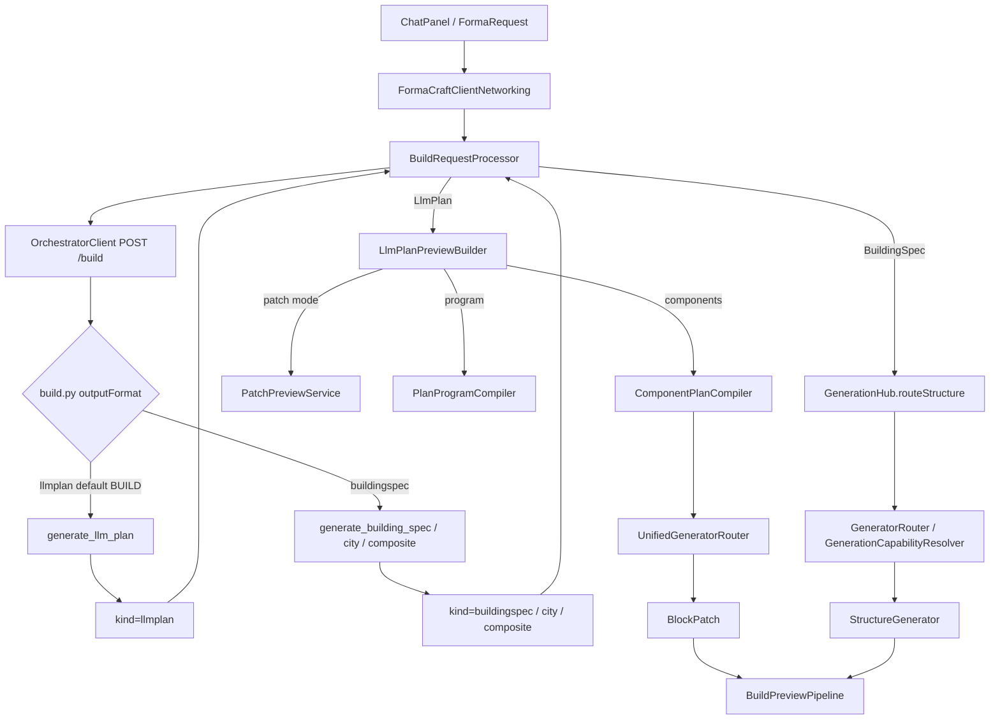

# Generation authority map

> **Maintenance:** When adding a build/plan entrypoint, update [config/generation_entrypoints.json](../../config/generation_entrypoints.json)（含 `methods` / `symbol`）and this document. CI runs `scripts/check_generation_entrypoints.py`、`check_active_docs.py`、`check_banned_resurrect.py`.

## Design authority (target)

| Layer | Owns design decisions | Owns geometry execution |
|-------|----------------------|-------------------------|
| User + LLM (Python) | Yes — components, roof/facade/entrance intent, style | No |
| Java compile | No silent substitutes | Yes — generators, post-process, terrain |
| BuildingSpec / StructureGenerator | Only when **explicitly** requested (landmark, template, `outputFormat=buildingspec`) | Yes |

See [CANONICAL_BUILDING_PLAN.md](CANONICAL_BUILDING_PLAN.md) and [DESIGN_DECISION_INVENTORY.md](DESIGN_DECISION_INVENTORY.md).

## End-to-end flow

## Path matrix

| Path | Trigger | Plan format | Who may add design params | Compiler / executor |
|------|---------|-------------|---------------------------|-------------------|
| **A** | `kind=llmplan`, `mode=build` | `LlmPlan.components[]` or `plan_program` | LLM/Python; Java only with `plan_meta.allow_compiler_satellites` (transition) | CPC / PPC → UGR |
| **A-patch** | `mode=patch` | `LlmPlan.patch` | LLM | PatchPreviewService |
| **B** | **仅**显式 `outputFormat=buildingspec` / `kind=buildingspec` | `BuildingSpec` | Compat only; not silent Java house fallback | GR → StructureGenerator |
| **B-edit** | `isPatch && requestsLegacyBuildingSpec` 或 `forma_edit_*` | Updated BuildingSpec/CitySpec JSON | `editLegacy*` → `/edit/building|/edit/city`（deprecated） | GR / city builders |
| **C** | 显式 buildingspec 下的 city / composite kinds | CitySpec / CompositeSpec | Compat | City / composite builders |
| **A-site** | Default LlmPlan multi-building / campus / garden compounds | Multiple MASS* + `building_id` + PATH/ROAD/COURTYARD/PLAZA (`from`/`to` strip or AABB) | LLM/user site composition; Java GEOMETRY only (`PathStripUtil`, `LlmPlanPathSmartEmit`→RoadPlanner) | CPC → UGR — **not** Path C / CityBuilder |

## Routing authority sources (must stay consistent)

| Source | What it decides | Should be |
|--------|-----------------|-----------|
| [prompt_assembly.py](../../python_backend/app/services/prompt_assembly.py) | `resolve_llm_plan_prompts` assembles the system and user prompts from structured request fields | Python owns prompt assembly for LlmPlan |
| [build.py](../../python_backend/app/routes/build.py) | llmplan vs buildingspec | Primary discriminator (`outputFormat`) |
| `FormaRequest.requestsLegacyBuildingSpec()` | Explicit legacy-format opt-in | Adapter-only scenarios |
| [GeneratorRouter.java](../../src/main/java/com/formacraft/server/generation/structure/router/GeneratorRouter.java) | Structure generator | `routeDecision()` — catalog / explicit routes only; never silent house/tower |
| [UnifiedGeneratorRouter.java](../../src/main/java/com/formacraft/server/generation/component/adaptor/UnifiedGeneratorRouter.java) | Component executor chain | `ComponentRouteResolver.resolve()` → early executors or `ComponentGenerationPipeline` driven by `ComponentPipelinePlan` steps |

## Failure semantics

- LlmPlan preview failure: **no** fake BuildingSpec fallback ([BuildRequestProcessor.java](../../src/main/java/com/formacraft/server/network/BuildRequestProcessor.java)).
- Missing design satellites on MASS: `E_DESIGN_INCOMPLETE` unless `plan_meta.allow_compiler_satellites=true` or explicit ROOF/FACADE/ENTRANCE components.
- Unmatched BuildingSpec type: `NEEDS_REPLAN`. Null type / null spec: `UNSUPPORTED`. No silent house/tower fallback.
- User/AI design vs hard spatial constraint: structured diagnostic / `capability_gap` (never silent success-after-rewrite). See `DesignDecisionPriority`.

## Default trunk call chain (Path A — code truth, Phase 01.1)

Production preview for `kind=llmplan` / `mode=build` with `components[]`:

1. `BuildRequestProcessor` → `LlmPlanPreviewBuilder.tryBuildPreview`
2. `ComponentPlanCompiler.compileWithCirculation` / `compile` (program → `PlanProgramCompiler`)
3. `ComponentEmitPass.compileComponents` → `GenerationHub.generateComponent` / `UnifiedGeneratorRouter`
4. `PatchOccupancyIndex` + `SurfaceOwnershipLedger` (write authority during emit)
5. `PostProcessPipeline` (controlled aesthetic / lighting / detail; opt-outs via `ExplicitDesignPolicy` / `AestheticPassHints`)
6. Final validation → Preview / `PreviewStorage`

| Entrypoint | Class | Role |
|------------|-------|------|
| **default trunk** | `LlmPlanPreviewBuilder` → `ComponentPlanCompiler` → `ComponentEmitPass` → UGR → occupancy/surface → `PostProcessPipeline` | Path A |
| **compat** | `LegacySpecPreviewHandler` / `GenerationHub.routeStructure` / `GeneratorRouter` | Path B BuildingSpec only when explicit |
| **compat** | `PlanProgramCompiler` | `plan_program` / skeleton when present on LlmPlan |
| **incremental (A-patch)** | `PatchPreviewService` / `LlmPlanPreviewBuilder` patch branches | `mode=patch` + `patch.blocks[]` or opening satellites; aesthetic skip via `IncrementalEditScope` (Phase 01.2 / P1-03) |

## Design-authority consumer inventory (Phase 01.1)

| Decision source | Priority (`DesignDecisionPriority`) | Actual consumers | Conflict behavior |
|-----------------|-------------------------------------|------------------|-------------------|
| World / spatial hard rules | `HARD_CONSTRAINT` | `PatchOccupancyIndex`, `SurfaceOwnershipLedger`, `StackedEnvelopeIntegrityValidator`, terrain/selection caps | Reject / gap; never redesign style |
| `design_sources` USER_EXPLICIT / seals | `USER_EXPLICIT` | `DesignProvenance.putIfAllowed`, `UserConstraintContract`, `ExplicitDesignPolicy`, `StyleIntentResolver`, satellite inference | Locked; conflicting hosted satellite → `E_EXPLICIT_DESIGN_CONFLICT` |
| `design_sources` AI_PLANNED | `AI_PLANNED` | Same provenance path; typology/style resolvers | Keep by default; hard conflict → gap |
| Geometry realizing authorized design | `GEOMETRY_EXECUTION` | Generators, `ComponentEmitPass`, roof/opening grammar | May derive voxels; must not invent roof/windows when opted out |
| Style / aesthetic fill | `STYLE_DEFAULT` | `AestheticPassHints`, Lighting/Detail/WindowOrder postprocessors | Fill gaps only; `none`/`off`/`false` / `no_complex_decor` win |
| Executor choice (`GenerationAuthority`) | orthogonal to aesthetic priority | `GenerationCompileContext`, UGR typology replace policy | COMPONENTS default; typology only when authority allows |

## Aesthetic / opt-out scopes (audit)

| Knob | Plan scope | Building / mass scope | Component scope | Notes |
|------|------------|----------------------|-----------------|-------|
| `no_complex_decor` | `proportion_hints` / building_contract `scope=plan\|all_main_masses` | contract `target_components` / mass param | mass / satellite params | Lighting honors plan **and** per-mass (Phase 00). Cross-building isolation covered by DesignIntent tests. |
| `lighting_style` | style attrs / plan | mass params | component params | Explicit `none` → no lanterns; `no_complex_decor` forces NONE when unset; `LightingPostProcessor.lightingOptOutCells` enforces per-mass `none` even when plan-level hints still default |
| `roof_type` / `window_style` / `entrance_type` / `wall_type` | contract requirements | mass params + `design_sources` | satellite params | `ExplicitDesignPolicy.*Disabled`; conflict → gap |
| `facade_relief` / material variation | style attrs | mass | postprocess | STYLE_DEFAULT fill only |

### Deferred residues (register only — not fixed in 01.1)

| ID | Item | Round |
|----|------|-------|
| P1-01 | Flat-roof perimeter REMOVE exemption needs opening provenance, not `isOpeningLike` alone | **01.4** |
| P1-03 | `isOpeningOnlyPatchPlan` ignored `mode=patch` | **Fixed in 01.2** — `IncrementalEditScope.suppressesAestheticExpansion` requires `mode=patch` |
| P1-04 | Postprocess scope rebuilt from prior PLACE seeds (`PostProcessPipeline`) | **01.3** |
| P1-05 | `chain`/`end_rod` soft→stone; hang-link vs lantern atomicity | **01.5** |
| Path smart-emit bypass | Route into GenerationHub authority | **01.6** |

## Related docs

- [GENERATION_PIPELINE.md](../GENERATION_PIPELINE.md) — operational pipeline truth
- [GENERATOR_ROUTING_MAP.md](../GENERATOR_ROUTING_MAP.md) — generator registry map
- [MIGRATION_LLMPLAN_VS_BUILDINGSPEC.md](../MIGRATION_LLMPLAN_VS_BUILDINGSPEC.md) — 构件/结构能力对照（非路由指南）
- [ARCHITECTURE_AUDIT.md](../refactoring/ARCHITECTURE_AUDIT.md) — 弃用退出清单
- [AI_DESIGN_AUTHORITY_GUARDRAILS.md](AI_DESIGN_AUTHORITY_GUARDRAILS.md) — AI design authority review contract (no silent redesign / implicit presets)
