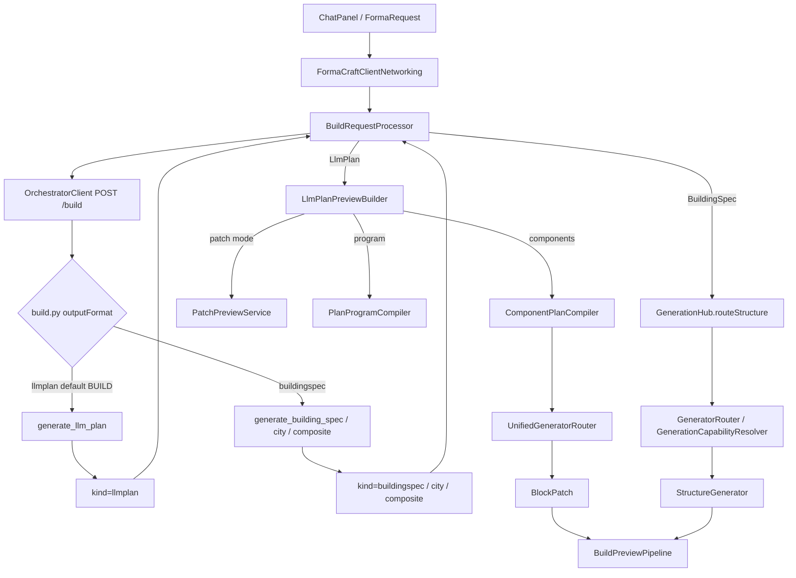

# Generation authority map

> **Maintenance:** When adding a build/plan entrypoint, update [config/generation_entrypoints.json](../../config/generation_entrypoints.json) and this document. CI runs `scripts/check_generation_entrypoints.py`.

## Design authority (target)

| Layer | Owns design decisions | Owns geometry execution |
|-------|----------------------|-------------------------|
| User + LLM (Python) | Yes — components, roof/facade/entrance intent, style | No |
| Java compile | No silent substitutes | Yes — generators, post-process, terrain |
| BuildingSpec / StructureGenerator | Only when **explicitly** requested (landmark, template, `outputFormat=buildingspec`) | Yes |

See [CANONICAL_BUILDING_PLAN.md](CANONICAL_BUILDING_PLAN.md) and [DESIGN_DECISION_INVENTORY.md](DESIGN_DECISION_INVENTORY.md).

## End-to-end flow

## Path matrix

| Path | Trigger | Plan format | Who may add design params | Compiler / executor |
|------|---------|-------------|---------------------------|-------------------|
| **A** | `kind=llmplan`, `mode=build` | `LlmPlan.components[]` or `plan_program` | LLM/Python; Java only with `plan_meta.allow_compiler_satellites` (transition) | CPC / PPC → UGR |
| **A-patch** | `mode=patch` | `LlmPlan.patch` | LLM | PatchPreviewService |
| **B** | `kind=buildingspec` | `BuildingSpec` | Python classifier + spec fields; not silent Java house fallback | GR → StructureGenerator |
| **B-edit** | PATCH prompt mode | Updated `BuildingSpec` JSON | LLM edit endpoint | GR |
| **C** | City / composite kinds | CitySpec / CompositeSpec | Python | City / composite builders |

## Routing authority sources (must stay consistent)

| Source | What it decides | Should be |
|--------|-----------------|-----------|
| [PromptAssembler.java](../../src/main/java/com/formacraft/client/ai/prompt/PromptAssembler.java) | Assembly vs landmark prompt blocks | Hints only (hard ASSEMBLY rule behind `formacraft.prompt.assemblyHardMandate`) |
| [build.py](../../python_backend/app/routes/build.py) | llmplan vs buildingspec | Primary discriminator (`outputFormat`) |
| [BuildingSpecRoutingPolicy.java](../../src/main/java/com/formacraft/common/generation/routing/BuildingSpecRoutingPolicy.java) | Client-side skip LlmPlan | Adapter-only scenarios |
| [GeneratorRouter.java](../../src/main/java/com/formacraft/server/generation/structure/router/GeneratorRouter.java) | Structure generator | `routeDecision()` — no silent house/tower unless `allow_legacy_fallback` |
| [UnifiedGeneratorRouter.java](../../src/main/java/com/formacraft/server/generation/component/adaptor/UnifiedGeneratorRouter.java) | Component executor chain | `ComponentRouteResolver.resolve()` → early executors or `ComponentGenerationPipeline` driven by `ComponentPipelinePlan` steps |

## Failure semantics

- LlmPlan preview failure: **no** fake BuildingSpec fallback ([BuildRequestProcessor.java](../../src/main/java/com/formacraft/server/network/BuildRequestProcessor.java)).
- Missing design satellites on MASS: `E_DESIGN_INCOMPLETE` unless `plan_meta.allow_compiler_satellites=true` or explicit ROOF/FACADE/ENTRANCE components.
- Unmatched BuildingSpec type: `NEEDS_REPLAN` / UNSUPPORTED unless `extra.allow_legacy_fallback=true`.

## Related docs

- [GENERATION_PIPELINE.md](../GENERATION_PIPELINE.md) — operational pipeline truth
- [GENERATOR_ROUTING_MAP.md](../GENERATOR_ROUTING_MAP.md) — generator registry map
- [MIGRATION_LLMPLAN_VS_BUILDINGSPEC.md](../MIGRATION_LLMPLAN_VS_BUILDINGSPEC.md) — gradual merge
