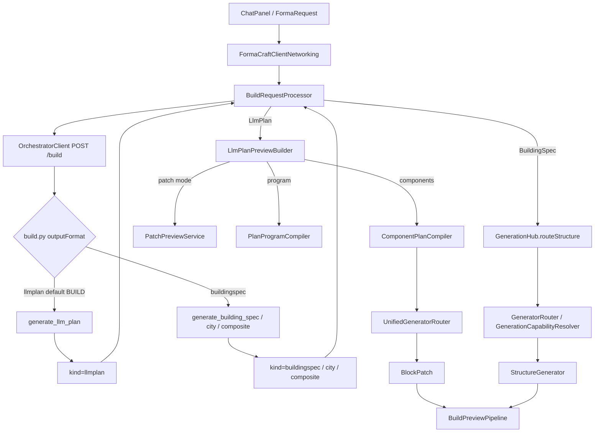

# Generation authority map

> **Maintenance:** When adding a build/plan entrypoint, update [config/generation_entrypoints.json](../../config/generation_entrypoints.json)（含 `methods` / `symbol`）and this document. CI runs `scripts/check_generation_entrypoints.py`、`check_active_docs.py`、`check_banned_resurrect.py`.

## Design authority (target)

| Layer | Owns design decisions | Owns geometry execution |
|-------|----------------------|-------------------------|
| User + LLM (Python) | Yes — components, roof/facade/entrance intent, style | No |
| Java compile | No silent substitutes | Yes — generators, post-process, terrain |
| BuildingSpec / StructureGenerator | Only when **explicitly** requested (landmark, template, `outputFormat=buildingspec`) | Yes |

See [CANONICAL_BUILDING_PLAN.md](CANONICAL_BUILDING_PLAN.md) and [DESIGN_DECISION_INVENTORY.md](DESIGN_DECISION_INVENTORY.md).

## End-to-end flow

## Path matrix

| Path | Trigger | Plan format | Who may add design params | Compiler / executor |
|------|---------|-------------|---------------------------|-------------------|
| **A** | `kind=llmplan`, `mode=build` | `LlmPlan.components[]` or `plan_program` | LLM/Python; Java only with `plan_meta.allow_compiler_satellites` (transition) | CPC / PPC → UGR |
| **A-patch** | `mode=patch` | `LlmPlan.patch` | LLM | PatchPreviewService |
| **B** | **仅**显式 `outputFormat=buildingspec` / `kind=buildingspec` | `BuildingSpec` | Compat only; not silent Java house fallback | GR → StructureGenerator |
| **B-edit** | `isPatch && requestsLegacyBuildingSpec` 或 `forma_edit_*` | Updated BuildingSpec/CitySpec JSON | `editLegacy*` → `/edit/building|/edit/city`（deprecated） | GR / city builders |
| **C** | 显式 buildingspec 下的 city / composite kinds | CitySpec / CompositeSpec | Compat | City / composite builders |
| **A-site** | Default LlmPlan multi-building / campus / garden compounds | Multiple MASS* + `building_id` + PATH/ROAD/COURTYARD/PLAZA (`from`/`to` strip or AABB) | LLM/user site composition; Java GEOMETRY only (`PathStripUtil`, `LlmPlanPathSmartEmit`→RoadPlanner) | CPC → UGR — **not** Path C / CityBuilder |

## Routing authority sources (must stay consistent)

| Source | What it decides | Should be |
|--------|-----------------|-----------|
| [prompt_assembly.py](../../python_backend/app/services/prompt_assembly.py) | `resolve_llm_plan_prompts` assembles the system and user prompts from structured request fields | Python owns prompt assembly for LlmPlan |
| [build.py](../../python_backend/app/routes/build.py) | llmplan vs buildingspec | Primary discriminator (`outputFormat`) |
| `FormaRequest.requestsLegacyBuildingSpec()` | Explicit legacy-format opt-in | Adapter-only scenarios |
| [GeneratorRouter.java](../../src/main/java/com/formacraft/server/generation/structure/router/GeneratorRouter.java) | Structure generator | `routeDecision()` — catalog / explicit routes only; never silent house/tower |
| [UnifiedGeneratorRouter.java](../../src/main/java/com/formacraft/server/generation/component/adaptor/UnifiedGeneratorRouter.java) | Component executor chain | `ComponentRouteResolver.resolve()` → early executors or `ComponentGenerationPipeline` driven by `ComponentPipelinePlan` steps |

## Failure semantics

- LlmPlan preview failure: **no** fake BuildingSpec fallback ([BuildRequestProcessor.java](../../src/main/java/com/formacraft/server/network/BuildRequestProcessor.java)).
- Missing design satellites on MASS: `E_DESIGN_INCOMPLETE` unless `plan_meta.allow_compiler_satellites=true` or explicit ROOF/FACADE/ENTRANCE components.
- Unmatched BuildingSpec type: `NEEDS_REPLAN`. Null type / null spec: `UNSUPPORTED`. No silent house/tower fallback.
- User/AI design vs hard spatial constraint: structured diagnostic / `capability_gap` (never silent success-after-rewrite). See `DesignDecisionPriority`.
- Peer MASS **3D** AABB collide without `allow_mass_separation` / soft-annex / intentional interlock → `E_MASS_FOOTPRINT_CONFLICT` (Phase 02.1). XZ-only / Y-disjoint stacks are not conflicts.
- Authored mass boolean CSG missing host → `E_MASS_CSG_HOST_MISSING`; oversized composite → `E_MASS_CSG_BUDGET` (Phase 02.2). `BuildingMassComposition` remains **explicit opt-in only** (`use_building_mass` / `-Dformacraft.useBuildingMass`).

## Mass composition authority (Phase 02.1 / 02.2)

| Concern | Owner | Notes |
|---------|-------|-------|
| Authored mass position / size | USER_EXPLICIT / AI_PLANNED | Java must not silently recenter or inflate to min-3 |
| Peer footprint separation | GEOMETRY repair (opt-in) | `MassFootprintSeparationRepair` + `MassSpatialRelation`; soft annex NONBINDING_HINT only |
| Nested tier auto-center | EXPLICIT params (`stepped`, `stack_mode`, `replace_envelope`, tier footprints) | `ResolvedMassPart` — contiguous Y alone insufficient |
| Boolean mass CSG (ADD/SUBTRACT/INTERSECT) | GEOMETRY on CPC trunk | Nested `params.masses[].operation` / peer `mass_operation`+`host_id` → `MassCsgPeerFoldRepair` → `MassMainGenerator` via `MassBooleanComposition` (ShapeLibrary boxes). Absent op → additive (no silent CSG). Phase 02.2.1: INTERSECT empty stays empty; illegal op → `E_MASS_CSG_OP_UNSUPPORTED`; fold uses `originInPlan`; legal empty host ≠ `required_component_empty` |
| CSG BuildingVolume / postprocess domain | GEOMETRY_EXECUTION contract | Emit copies immutable `CsgResult` (+ plan-space origin) into `BuildingVolume`; AABB cull vs `domainContains` / `isProtectedVoid`. ThreadLocal geometry context does **not** span postprocess. Non-CSG stepped: nested `ResolvedMassPart` UNION domain (not host-envelope constant section). |
| Mass separation / CONNECTION_SEAM | HARD_CONSTRAINT + soft-annex NONBINDING_HINT | Seam needs opt-in, soft-annex GAP, passage link, or authored COMPOUND join; chosen mover must be authorized (except passage/COMPOUND GEOMETRY); interlock via pair / multi-peer ids |
| Multi-mass junction (Phase 02.3.3) | USER/AI intent + Java GEOMETRY | Explicit `junction_intent` (`shared_wall` / `open_connection` / `passage` / `intentional_interlock` / `vertical_connection`); `MassDomainRelation` AABB broad + domain narrow; never auto-open on mere CONTACTING; elevation / narrow-passage → `E_JUNCTION_*` gaps |
| Junction hardening (Phase 02.3.3.1) | USER/AI pair edges + Java GEOMETRY / HARD_CONSTRAINT | Pair-scoped `junctions` / `junction_by_peer` (no peerless broadcast; conflict → `E_JUNCTION_INTENT_CONFLICT`, never open-wins); plan/slot/host-local single-offset; `MassJunctionRepair` after separation/floor/footprint freeze; through-thickness OMIT+CARVE+floor PLACE; cell-scoped interlock + `PlaceRecord.originalOwner` anti A→B→C; `ResolvedMassPart.syntheticEnvelope` |
| Junction closeout + voids (Phase 02.3.4) | USER/AI spatial use + Java GEOMETRY / HARD_CONSTRAINT | Exact contact openings (no synthesize); domain-authoritative deletes only; `JunctionGrantIndex` pair grants (empty=deny); geometry freeze then junction then `ProtectedSpaceRepair`; `protected_spaces` kinds (COURTYARD/ATRIUM/STAIRWELL/PILOTIS/PASSAGE/DOUBLE_HEIGHT) are spatial uses not building presets; OMIT/CARVE/PLACE/PROTECT consumers; EmitPass soft-clips PROTECT; `SpatialDomainQuery` unified domain |
| Multi-peer interlock occupancy | HARD_CONSTRAINT | `intentional_interlock_peer_ids` pairwise mutual; A↔B and B↔C ≠ A↔C; no component-wide `allow_patch_overwrite` |
| Stepped cue promotion | FORMAT_REPAIR | `SteppedMassCueRepair` honors local `stepped=false` / explicit `stack_mode` / eccentric XZ offsets |
| CSG spatial domain + wall shell + floors | GEOMETRY on CPC trunk | Indexed `CsgResult`; parse-once domain; hollow `shellWalls(t)` / solid fill; `Floor(y)=DomainFootprint(y)−ProtectedVoids`; explicit ADD/UNION nested `masses[]≥2` → unified UNION shell (bare stepped tiers unchanged); `E_MASS_WALL_THICKNESS` / `E_FLOOR_LAYOUT_OVERFLOW` |
| Storey band contract | FORMAT_REPAIR + HARD_CONSTRAINT | `floor_height`/`ground_clear_height` = band incl. slab; `slab_thickness` default 1; clear = band−slab; locked/hard conflict → overflow gap; soft unlocked height may grow |
| Mass separation mover auth | HARD_CONSTRAINT | Chosen mover must hold `allow_mass_separation` / plan opt-in / soft-annex self; peer stamp does not transfer |
| BMC `allowsBlockAt` INTERSECT | EXPLICIT_TEMPLATE path only | Finished for opt-in `BuildingMassPipeline`; never default route |

## Default trunk call chain (Path A — code truth, Phase 01.1)

Production preview for `kind=llmplan` / `mode=build` with `components[]`:

1. `BuildRequestProcessor` → `LlmPlanPreviewBuilder.tryBuildPreview`
2. `ComponentPlanCompiler.compileWithCirculation` / `compile` (program → `PlanProgramCompiler`)
3. `ComponentEmitPass.compileComponents` → `GenerationHub.generateComponent` / `UnifiedGeneratorRouter`
4. `PatchOccupancyIndex` + `SurfaceOwnershipLedger` (write authority during emit)
5. `PostProcessPipeline` (controlled aesthetic / lighting / detail; opt-outs via `ExplicitDesignPolicy` / `AestheticPassHints`)
6. Final validation → Preview / `PreviewStorage`

| Entrypoint | Class | Role |
|------------|-------|------|
| **default trunk** | `LlmPlanPreviewBuilder` → `ComponentPlanCompiler` → `ComponentEmitPass` → UGR → occupancy/surface → `PostProcessPipeline` | Path A |
| **compat** | `LegacySpecPreviewHandler` / `GenerationHub.routeStructure` / `GeneratorRouter` | Path B BuildingSpec only when explicit |
| **compat** | `PlanProgramCompiler` | `plan_program` / skeleton when present on LlmPlan |
| **incremental (A-patch)** | `PatchPreviewService` / `LlmPlanPreviewBuilder` patch branches | `mode=patch` + `patch.blocks[]` or opening/recolor/remove/satellite-add; aesthetic skip when Ω=`authorizedWriteCells` non-empty (Phase 01.2 / 01.9 Task E) |

## Design-authority consumer inventory (Phase 01.1)

| Decision source | Priority (`DesignDecisionPriority`) | Actual consumers | Conflict behavior |
|-----------------|-------------------------------------|------------------|-------------------|
| World / spatial hard rules | `HARD_CONSTRAINT` | `PatchOccupancyIndex`, `SurfaceOwnershipLedger`, `StackedEnvelopeIntegrityValidator`, terrain/selection caps | Reject / gap; never redesign style |
| `design_sources` USER_EXPLICIT / seals | `USER_EXPLICIT` | `DesignProvenance.putIfAllowed`, `UserConstraintContract`, `ExplicitDesignPolicy`, `StyleIntentResolver`, satellite inference | Locked; conflicting hosted satellite → `E_EXPLICIT_DESIGN_CONFLICT` |
| `design_sources` AI_PLANNED | `AI_PLANNED` | Same provenance path; typology/style resolvers | Keep by default; hard conflict → gap |
| Geometry realizing authorized design | `GEOMETRY_EXECUTION` | Generators, `ComponentEmitPass`, roof/opening grammar | May derive voxels; must not invent roof/windows when opted out |
| Style / aesthetic fill | `STYLE_DEFAULT` | `AestheticPassHints`, Lighting/Detail/WindowOrder postprocessors | Fill only when param class is ABSENT (Phase 01.9); DISABLED (`none`/`off`/`false`/`0`) resolves to concrete NONE/OFF — never silent STYLE_DEFAULT refill |
| Executor choice (`GenerationAuthority`) | orthogonal to aesthetic priority | `GenerationCompileContext`, UGR typology replace policy | COMPONENTS default; typology only when authority allows |

## Aesthetic / opt-out scopes (audit)

| Knob | Plan scope | Building / mass scope | Component scope | Notes |
|------|------------|----------------------|-----------------|-------|
| `no_complex_decor` | `proportion_hints` / building_contract `scope=plan\|all_main_masses` | contract `target_components` / mass param | mass / satellite params | Lighting honors plan **and** per-mass (Phase 00). Cross-building isolation covered by DesignIntent tests. |
| `lighting_style` | style attrs / plan | mass params | component params | Explicit `none` → no lanterns; `no_complex_decor` forces NONE when unset; `LightingPostProcessor.lightingOptOutCells` enforces per-mass `none` even when plan-level hints still default |
| `roof_type` / `window_style` / `entrance_type` / `wall_type` | contract requirements | mass params + `design_sources` | satellite params | `ExplicitDesignPolicy.*Disabled`; conflict → gap |
| `facade_relief` / material variation | style attrs | mass | postprocess | STYLE_DEFAULT fill only |

### Deferred residues (register only — not fixed in 01.1)

| ID | Item | Round |
|----|------|-------|
| P1-01 | Flat-roof perimeter REMOVE exemption needed opening provenance | **Fixed in 01.4**; **hardened in 01.9** — `openingCarvable` ≠ coverage exemption; host-scoped `authorizedOpeningCellsForOwner`; authority-only unoccupied OK |
| P1-03 | `isOpeningOnlyPatchPlan` ignored `mode=patch` | **Fixed in 01.2** — `IncrementalEditScope.suppressesAestheticExpansion` requires `mode=patch` |
| P1-04 | Postprocess scope rebuilt from prior PLACE seeds | **Fixed in 01.3** — `PostProcessContext.authorizedWriteScope` frozen at pipeline entry; `PostProcessWriteScope.forStep` + shared delta scope |
| P1-05 | `chain`/`end_rod` soft→stone; hang-link vs lantern atomicity | **Fixed in 01.5** — `PlanPatchConverter.softSubstitute` (hangable / skip, never stone); `LightingPostProcessor` hang pairs commit/filter atomically |
| Path smart-emit bypass | Route into GenerationHub authority | **Fixed in 01.6** — `ComponentEmitPass` always calls `GenerationHub.generateComponentResult(…, globalAnchor)`; `UnifiedGeneratorRouter` may run `LlmPlanPathSmartEmit` only under `COMPONENTS` (never `CAPTURED_LIBRARY` / explicit library); BlockState via `BlockStateStringUtil.fromState` |

### Surface / opening write roles (Phase 01.4)

| Role | Typical writer | Notes |
|------|----------------|-------|
| `WALL` | MASS / shell | Same-host openings may carve |
| `ROOF` | ROOF / mass deck | Not punched by façade windows; `openingCarvable` = may accept openings later (CARVABLE), never flat-roof coverage exemption (01.9) |
| `WINDOW` / `FACADE_OPENING` | FACADE_WINDOWS / mass glazing | Authorizes flat-roof perimeter coverage exemption |
| `DOOR_OPENING` | ENTRANCE | Authorizes coverage exemption; circulation clearance also authorizes |

### Lighting / décor soft recovery (Phase 01.5)

| Case | Behavior |
|------|----------|
| Resolvable lantern / chain / end_rod | Place as authored |
| Unresolved `chain` | Soft → `iron_bars` (hangable) |
| Unresolved `end_rod` | Soft → `sea_lantern` |
| Unresolved optional flower/carpet/… | Skip + warn (no stone) |
| Tall-storey hang link + fixture | Atomic `HangPair` — place / opt-out / scope filter both or neither |
| User-explicit structural unknown | Still `criticalInvalid` |

### Write attribution / quality diagnostics (Phase 01.7 / 01.9)

| Artifact | Role |
|----------|------|
| `WriteAttribution.Report` | Developer trace: component, host, position, current occupancy / opening / post-process writers, violation, resolution |
| `Report.currentOccupancyWriter()` | Alias of `originalWriter` — index stores one current holder, not lineage history |
| `fromPostProcessConflict` | `E_POSTPROCESS_PATCH_CONFLICT` → same `toDetails()`; `OUT_OF_SCOPE_WRITE` / `CLEARANCE_VIOLATION` / opening / surface / unauthorized |
| `PROTECTED_OPENING_OVERWRITE` | Surface conflict on WINDOW / DOOR / FACADE_OPENING |
| `UNAUTHORIZED_PLACE_OVERWRITE` | Occupancy / final-pass unauthorized PLACE |
| `CapabilityGap.details` | Structured keys + `attribution` multi-line text (logs / quality — not player chat) |
| `WriteAttribution.trace` | Probe a cell without asserting a violation |

### Phase 01.9 / Final Closeout status

P0–P2 of 01.9 plus closeout: `check`/`checkHost` share host-scoped openings; `BuildingVolume.lightingAllowed` identity; incremental Ω frozen via `PostProcessWriteScope.exactCells`. See [PHASE_01_9_DELIVERY_REPORT.md](PHASE_01_9_DELIVERY_REPORT.md). **Phase 01 architecture governance stopped.** In-game soak remains manual/CI.

## Related docs

- [GENERATION_PIPELINE.md](../GENERATION_PIPELINE.md) — operational pipeline truth
- [GENERATOR_ROUTING_MAP.md](../GENERATOR_ROUTING_MAP.md) — generator registry map
- [MIGRATION_LLMPLAN_VS_BUILDINGSPEC.md](../MIGRATION_LLMPLAN_VS_BUILDINGSPEC.md) — 构件/结构能力对照（非路由指南）
- [ARCHITECTURE_AUDIT.md](../refactoring/ARCHITECTURE_AUDIT.md) — 弃用退出清单
- [AI_DESIGN_AUTHORITY_GUARDRAILS.md](AI_DESIGN_AUTHORITY_GUARDRAILS.md) — AI design authority review contract (no silent redesign / implicit presets)
