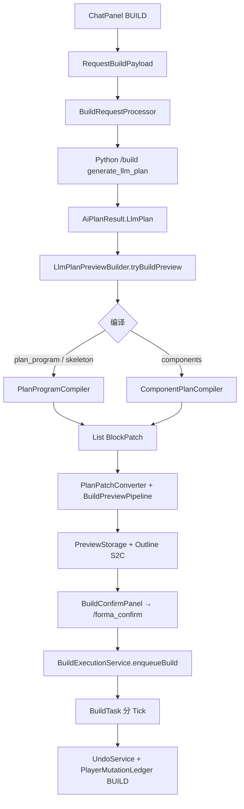
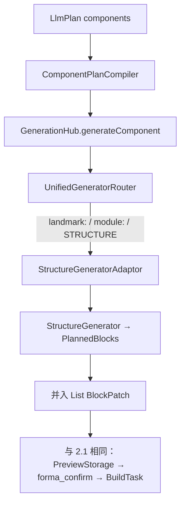
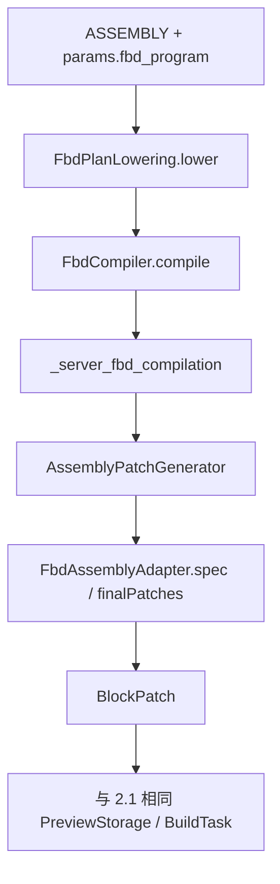
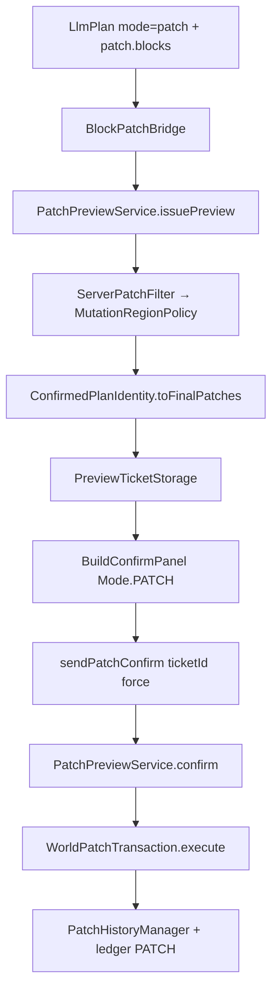

# Phase 1 · Golden Path 稳定化审计

状态：进行中 · 基线提交 `ff7039cd5376` · 核查日 2026-10-25  
范围：真实 Preview → Confirm → Apply → Undo/Redo；**不含**大规模风格扩充或新 DSL。

> **诚实边界**：本文件基于代码与文档静态审计。未启动 Minecraft 客户端、专用服务器或多人会话。标有 `Requires In-Game Test` 的项不得计为已完成。

相关契约：[GENERATION_PIPELINE.md](../GENERATION_PIPELINE.md) · [WORLD_MUTATION_CONTRACT.md](../WORLD_MUTATION_CONTRACT.md) · [FBD_EXPERIMENTAL.md](../FBD_EXPERIMENTAL.md) · [CI_VERIFICATION.md](../architecture/CI_VERIFICATION.md) · [游戏内验收矩阵](INGAME_ACCEPTANCE_MATRIX.md)

---

## 1. 结论摘要

| 判断 | 证据 |
|------|------|
| LlmPlan 是文档与 Chat 默认主干 | `ChatPanel` 默认 `PromptMode.BUILD` + `outputFormat=llmplan`；`docs/GENERATION_PIPELINE.md` |
| 运行时仍存在平行写入栈 | Build：`PreviewStorage` → `/forma_confirm` → `BuildTask`；Patch：`PreviewTicket` → C2S confirm → `WorldPatchTransaction` |
| Patch 路径冻结契约更完整 | `ConfirmedPlanIdentity.toFinalPatches` + ticket 内 patches 与 Apply 同源；`BuildExecutionStatus` 仅 SUCCESS 入历史 |
| Build 路径缺少全批原子回滚 | `WORLD_MUTATION_CONTRACT.md`「未做：BuildTask 全批原子回滚」 |
| 玻璃板 Undo 容错已落地（离线） | `ReplaySnapshotMatcher` + `PaneReplayTest`；墙/栅栏**未**放宽 |
| CI 绿 ≠ 游戏内验收 | `docs/architecture/CI_VERIFICATION.md` 明文 |

**Phase 1 产品目标**：证明一条普通住宅自然语言建造在真实世界中 Preview / Confirm / Apply / Undo / Redo 行为一致，并堵住会破坏该信任的合同债。

---

## 2. 四条执行流（代码真相）

### 2.1 普通建筑（LlmPlan components / PlanProgram）

关键类：`LlmPlanPreviewBuilder`、`ComponentPlanCompiler`、`PlanProgramCompiler`、`PreviewStorage`、`FormaCraftCommands`（`forma_confirm`）、`BuildExecutionService`、`UndoService`、`MutationHistoryFacade`。

### 2.2 地标 / landmark 模块（精品例外，仍经 LlmPlan 入口）

独立平行入口（绕过 LlmPlan 编译）：`AiPlanResult.BuildingSpec` / `CompositeSpec` / `CitySpec` → `BuildRequestProcessor.previewBuildingSpec|previewCompositeSpec|previewCitySpec` → `BuildPreviewDelivery` → 仍进 `PreviewStorage` + `BuildTask`。

### 2.3 FBD 程序（实验；挂在 LlmPlan ASSEMBLY 上）

契约：`docs/FBD_EXPERIMENTAL.md`。程序内 last-write-wins（`FbdAssemblyAdapter.finalPatches`）；跨构件覆盖仍受现有 Patch 授权约束。不提供已落地 FBD 建筑的替换编辑。

### 2.4 增量 Patch（`LlmPlan.Mode.patch`）

冻结不变量（代码注释与实现一致）：质量报告、Ticket patches、客户端预览、Apply 共用同一 `acceptedFinal`。

---

## 3. 平行入口与不一致点

| ID | 分叉 | 风险 | 优先级 |
|----|------|------|--------|
| D1 | `PreviewStorage` vs `PreviewTicket` | Confirm 门禁、消费语义、客户端 Mode 不同 | P0 |
| D2 | `BuildTask` vs `WorldPatchTransaction` | Build 无全批原子回滚；失败可能部分写入却进入/不进入历史语义不一 | P0 |
| D3 | `UndoService` vs `PatchHistoryManager` | 靠 `MutationHistoryFacade` + ledger 择栈；跨栈 UX / 幽灵条目需实机验证 | P0 |
| D4 | BuildingSpec / City / Composite 整栋路径 | 跳过 `ComponentPlanCompiler`；过滤走 `BuildConstraintClipper` | P1 |
| D5 | `UnifiedGeneratorRouter` landmark 中途整栋 | LlmPlan 内混入 StructureGenerator 几何 | P1 |
| D6 | `BlockPatchBridge.safeTarget` 空 id → `minecraft:stone` | 静默软化；编译器路径更严 | P1 |
| D7 | `/forma_*` 命令直调 `CityBuilder` / `routeStructure` | 与 Chat 主干旁路 | P2 |
| D8 | `editBuilding`（PATCH/MODIFY_REGION） | 增量编辑平行于全量重建 | Phase 3 |
| D9 | FBD 与普通构件同槽冲突 | `FbdPlanLowering` 已硬拒绝；需回归锁住 | 已有防护 |

过滤对照（合同已写明，审计确认仍成立）：

- Patch：`ServerPatchFilter` → `MutationRegionPolicy.allow`
- Build：预览期 `BuildConstraintClipper` + `BuildConstraints`；`BuildTask` 不再二次裁剪

共享：`BlockMutationAccess`（架构检查禁止新增旁路）。

---

## 4. 冻结预览 = 实际应用？

| 路径 | 冻结机制 | 审计结论 |
|------|----------|----------|
| Patch Ticket | `PreviewTicket.patches` = `toFinalPatches(filtered)`；`patchIntegrityOk`；可选 `expectedStates` | **是**（同集） |
| Palace 冻结计划 | `bindOrRefuseFrozenPlan`；拒绝静默降级 | **是**（同集或拒绝） |
| Build PreviewStorage | 存 `GeneratedStructure`（PlannedBlock）；confirm 一次性 `consumeStructure` | **是**（结构 digest + 维度）；但写入器不是 `WorldPatchTransaction` |

---

## 5. 失败 / 取消 / 过期 / 重复确认 / 多人（代码态）

| 场景 | Patch 路径 | Build 路径 | 离线覆盖 | Requires In-Game Test |
|------|------------|------------|----------|------------------------|
| 取消 | `PreviewTicketStorage.cancel` | `/forma_cancel` → clear PreviewStorage | 部分 | 是 |
| 过期 | Ticket TTL 5min + tick purge | 无同等 Ticket TTL；依赖玩家预览态 | Ticket：有单测 | Build 过期语义 |
| 重复确认 | CAS `consume` 仅一次 | `consumeStructure` 一次性 | Ticket：有 | 是 |
| 质量 ERROR | 需 force；与 UI 二次确认对齐 | `/forma_confirm force` | 部分 | 是 |
| 距离门禁 | ≤96 格，先校验再 consume | 维度 + digest | 部分 | 是 |
| 跨玩家 | Ticket 绑定 playerId | PreviewStorage 按 UUID | Ticket：有 | 多人实机 |
| 部分失败回滚 | `WorldPatchTransaction` Recover + status | BuildTask **未做**全批回滚 | Patch：有 | Build 中断 |

---

## 6. 客户端 / 服务端边界（抽查）

| 规则 | 状态 |
|------|------|
| 服务端不读客户端全局工具态 | 文档要求；请求带 DTO/快照 |
| 世界写入仅服务端 | `BuildTask` / `PatchExecutor` 在 server |
| Confirm 不信任客户端上传未过滤 patches | Ticket 消费服务端冻结集；Build 消费服务端 PreviewStorage |
| Dedicated server 启动 | `Requires In-Game Test`（CI 明文不覆盖） |

---

## 7. P0 / P1 修复清单（按验收顺序）

### P0 — 本阶段必须推进

1. **游戏内主干矩阵**（见 [INGAME_ACCEPTANCE_MATRIX.md](INGAME_ACCEPTANCE_MATRIX.md)）  
   一座小型住宅：Chat → Preview → Confirm → Apply → Undo → Redo。硬门槛：无 unknown command；落点与预览一致；Undo 恢复；不把 CI 绿当通过。

2. **记录 Build vs Patch 差距为可跟踪债**  
   不在本轮合并执行器。先保证：同一玩家 Undo 经 `MutationHistoryFacade`；失败/取消文案可区分两条路径。可选最小修复：BuildTask 中断时不得把部分写入记成成功历史。

3. **玻璃板 Undo 扩边界（不放宽墙/栅栏）**  
   已有 `PaneReplayTest`。补：墙/栅栏连接差异仍为冲突（契约锁定测试）；`Requires In-Game Test`：真实邻居更新下行/角玻璃 Undo×2。

### P1 — 主干稳定后

4. 收敛或明确标注 BuildingSpec/City 为兼容路径；Chat 默认禁止静默落到 BuildingSpec。  
5. `BlockPatchBridge.safeTarget`：空 target 改为拒绝或与编译器一致报错，去掉 stone 静默默认。  
6. FBD 四类小场景离线+游戏内核对（亭廊、坡地、碰撞、同坐标覆盖）——进入 Phase 3 文档前完成，**不扩原语**。  
7. 核对 `f7679482` 资源清理后 JAR 仍含风格卡/Schema/示例（打包检查，非仅仓库文件存在）。

### 明确不做（本阶段）

- 大规模风格扩充  
- 新建筑 DSL / 第二套生成主干  
- 合并 BuildTask 与 WorldPatchTransaction（需独立设计轮次）  
- 放宽全部方块状态的 Undo 比较

---

## 8. 自动化 vs 游戏内

| 已有离线能力 | 仍需游戏内 |
|--------------|------------|
| `PreviewTicketStorageTest`（one-shot / 跨玩家 / 过期 purge） | Dedicated server 启动与模组加载 |
| `PreviewPlanApplyE2ETest`（冻结 patches Apply + Undo） | ChatPanel → 真实预览线框 → Confirm |
| `PaneReplayTest` + `ReplaySnapshotMatcher` | 真实邻居更新下的玻璃/墙 |
| `WorldPatchTransaction` 状态机单测 | BuildTask 中途退出 / 区块卸载 |
| `eval.ci_gate`、Gradle check | 玩家步行入口、多层通行观感 |

---

## 9. 本轮已交付工件

| 工件 | 路径 |
|------|------|
| 本审计 | `docs/phase1/GOLDEN_PATH_AUDIT.md` |
| 游戏内验收矩阵 | `docs/phase1/INGAME_ACCEPTANCE_MATRIX.md` |
| 游戏内提示词 | `docs/phase1/INGAME_TEST_PROMPTS.md` |
| 2026-10-25 实测分诊 | `docs/phase1/INGAME_FINDINGS_2026_10_25.md` |
| 墙/栅栏严格比较契约测试 | `src/test/.../ConnectedBlockReplayContractTest.java` |
| A2 意图→PATCH + 拒整栋 | `PromptModeResolver`、`ChatPanel`、`BuildRequestProcessor`、`LlmPlanPreviewBuilder` |

下一动作：重测 A2（增量应 PATCH / 拒整栋）；补 A4 `latest.log`；再按 P1 排期修门窗朝向与屋顶连续。
