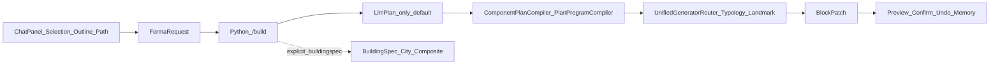

# 架构审计 — 当前状态

状态：维护中；复核：2026-11-15（PR-0 证据基线 + 弃用退出清单）。

历史分批记录已移至 [archive/ARCHITECTURE_AUDIT_batches_through_2026-10-25.md](archive/ARCHITECTURE_AUDIT_batches_through_2026-10-25.md)。以本页与门禁脚本为准，不以历史「债务 0」表述为准。

## 证据基线（PR-0）

| 项 | 值 |
|---|---|
| Git SHA | `810e0c64b2db622fdf9e90a8c6cf108a5cc6963f` |
| 提交摘要 | `refactor(ai_planner): 添加兼容性重新导出以保持调用接口稳定` |
| 本轮范围 | 仅文档与证据台账；**不改**生成算法默认值；**不删**仍有消费者的兼容路径 |
| 本地门禁（本轮） | `python scripts/check_architecture.py`、`python scripts/check_generation_entrypoints.py` |
| PR-2 门禁 | `check_generation_entrypoints`（符号/方法）、`check_active_docs`、`check_banned_resurrect`；跨语言 API 矩阵测试；预览失败记 `preview_unhandled_no_structure_fallback` |
| PR-6 门禁（新增） | `check_doc_dead_symbols`（活文档不得把已删类型当作现行实现；归档文档豁免）；`check_banned_resurrect` 清单扩充至 43 项 |

### 现行入口调用图（默认 canonical + 显式 compat）

单一计划协议 = **LlmPlan**。House / Tower / 地标 / 参数化构件可作为**执行器**保留，禁止独立规划 / 预览 / 确认链。

### Preview / Undo 不变量（未决事务债）

| 栈 | 预览载体 | 确认 | 历史 | 契约 |
|---|---|---|---|---|
| Build（结构） | `PreviewStorage`（digest + 维度 + origin） | `/forma_confirm` 一次性 `consume` | `UndoService` | [WORLD_MUTATION_CONTRACT](../WORLD_MUTATION_CONTRACT.md)、[MEMORY_TRANSACTION_CONTRACT](../MEMORY_TRANSACTION_CONTRACT.md) |
| Patch（增量） | `PreviewTicket` / `PreviewTicketStorage` | C2S confirm 消费冻结 patches | `PatchHistoryManager` | 同上 |

未决：两套预览确认 UX 未合并；`UndoService` 与 `PatchHistoryManager` 靠 `MutationHistoryFacade` + ledger 择栈，跨栈 UX / Memory 原子性见「未决项」。**本轮不合并存储。**

## 当前门禁

| 检查 | 命令 | 期望 |
|---|---|---|
| 包边界 + common 服务端类型冻结 | `python scripts/check_architecture.py` | exit 0；新增引用必须先消债再改基线 |
| StructureGenerator 冻结 | `python scripts/check_structure_generator_freeze.py` | register 调用数 = baseline |
| Panel 行数（软） | `python scripts/check_panel_line_budget.py` | 仅打印超标 |
| 生成入口（含符号/方法） | `python scripts/check_generation_entrypoints.py` | exit 0 |
| Tier-0 活文档禁已删符号 | `python scripts/check_active_docs.py` | exit 0 |
| 禁止复活已删入口 | `python scripts/check_banned_resurrect.py` | exit 0 |

`config/architecture-debt.json` 中登记的 common 服务端类型引用现已清空；**禁止新增**。包引用 `com.formacraft.server` 在 common 中应保持为 0。

## 未决项（优先）

- 编译状态继续由 ThreadLocal 迁至显式参数；路由器的逐字段 setter/clearer 已删除，统一使用 `GenerationCompileContext`。世界只读快照后，计划编译可完全离开主线程
- `ai_planner.py` 继续按阶段拆分
- Panel 超 400 行拆分（Settings / Chat / ComponentCapture）
- 双 JSON 库收敛（新代码优先 `common.json.JsonUtil` / Gson）；服务端硬编码中文文案迁语言文件（建造门控文案已走 lang）
- Memory 落盘与世界修改原子性；Undo 双轨统一（见 WORLD_MUTATION_CONTRACT）
- ~~PR-2 指标误记账~~：已改为 `recordError(..., preview_unhandled_no_structure_fallback)`；勿用修复前历史 fallback 率做迁移决策
- ~~PR-3 compat 拆分~~：`LegacySpecPreviewHandler` / `LegacyBuildingEditHandler`（工作区待提交）
- ~~PR-4 双栈语义冻结~~：见 [PREVIEW_UNDO_INVARIANTS](../PREVIEW_UNDO_INVARIANTS.md)；**未**合并 Preview/Undo 存储
- ~~PR-5 首批无消费者删除~~：MassAssembly 孤儿子图 + 死 fallback 指标 API（LEGACY-017/018）
- ~~PR-5b 无消费者删除~~：PathCluster K1 死路径 + 未注册/未接线孤类（LEGACY-019/020）
- ~~PR-5c 无消费者删除~~：未接线 socket/client/skeleton 脚手架（LEGACY-021）
- ~~PR-5d 无消费者删除~~：PathCluster 整图级联 + continuous 包 + ToolConstraint 级联孤类（LEGACY-022）
- ~~P1-1 `/build` 跨语言请求形状误判~~：嵌套请求不再被降级为扁平格式（LEGACY-023）
- ~~P1-2 旧编辑事务与门禁边界~~：预览失败不覆盖旧规格，门禁覆盖预览全过程（LEGACY-024）
- 后续：残余 REMOVABLE（有测试/Python 引用的另核）；Preview/Undo 存储合并（需 Memory 原子）；`check_generation_entrypoints` 定位为轻量静态守卫（需集成测试保证端点可运行）

## 已落地（2026-10-31 审查整改）

- `ExplicitDesignPolicy.isExplicitlyDisabled` 下沉 common，架构门禁恢复
- 后端默认 `127.0.0.1` + `FORMACRAFT_ORCHESTRATOR_SECRET` / `X-FormaCraft-Secret`
- `/models` 走 `url_safety`；日志打码 `searchApiKey`；健康检查缓存
- 聊天建造权限 / 限流 / 并发；`GenerationCompileContext` + `PlanCompileWorkers`
- 提示词组装迁至 Python 后端，已删除 Java `PromptAssembler` 和旧地标 BuildingSpec 模板生成函数
- 能力矩阵见 [GENERATION_CAPABILITY_MATRIX.md](GENERATION_CAPABILITY_MATRIX.md)；边界见 [PYTHON_JAVA_PLANNING_BOUNDARY.md](../PYTHON_JAVA_PLANNING_BOUNDARY.md)

## 编译上下文迁移（2026-11-14）

`UnifiedGeneratorRouter` 已移除 `set/clearTypologyExclusivePlan`、`set/clearPlanGenerationAuthority` 和 `set/clearPlanMeta` 六个旧入口。调用方通过 `GenerationCompileContext.runWith` 安装完整上下文；编译器在组件生成结束、能力缺口返回或异常退出时恢复进入前的上下文。当前上下文存储仍使用 ThreadLocal。

回归覆盖路由权限、typology 排他规则，以及真实编译的成功、能力缺口和异常退出后的外层状态恢复。

几何缓存的生产编译入口改用 `BuildingGeometryContext.open()`，通过 try-with-resources 隔离每层缓存并在异常退出后恢复外层状态。旧 begin/end 调用已迁移并删除，缓存底层仍使用 ThreadLocal。

编译上下文已删除无调用者的 withAuthority、withPlanMeta、withTypologyExclusive 和 clear 方法。planMeta 保存独立的顶层 Map 快照，保留空值；嵌套集合仍沿用原引用。回归验证源 Map 修改隔离、只读访问和嵌套异常恢复。

几何缓存已合并为一个可空的线程状态。作用域外的生成只解析几何，不写缓存；最外层作用域关闭时移除线程引用，嵌套关闭仍恢复外层缓存。

## 隔离路径清理（2026-11-14）

已核对旧 AutoAssembler、ClusterLayoutPlanner 和 ConfirmBuildPacket 的删除状态，修正架构概览中的待删除列表。BuildingMassSystemTest 仍由服务端命令调用，已迁至 server.command.diagnostic，保留原诊断行为。common.mass 中的实际调用链继续冻结迁移。

BuildingMassSystemIntegrator 已删除未使用的 ServerWorld 参数，预览入口改为只传计划和世界锚点。对应 common 服务端类型债务减少 3 处；显式启用条件和生成行为沿用原实现。

LandmarkRoutingMetrics、TypologyRoutingMetrics、LlmPlanRoutingMetrics 改为接收玩家名称字符串，服务端调用方负责读取名称。指标类不再依赖 ServerPlayerEntity，保留缺失玩家时的原日志占位符，边界债务再减少 18 处，剩余 65 处。

FcaLog 已删除接收玩家实体的 player 方法，服务端唯一调用点复用 playerId(String)。日志工具不再依赖服务端玩家类型，边界债务再减少 3 处，剩余 62 处。

SocketFinder 的三个空实现查找方法及 SocketProviders.findFromInstances 包装链已删除，无业务调用者。保留工具上下文收集与排序，世界实例扫描仍待实现。对应边界债务减少 8 处，剩余 54 处。

SkeletonSocketGenerator 无运行时、测试或构建调用者，且未从骨架填充查询几何，已删除并标注历史文档。边界债务减少 3 处，剩余 51 处。

地形后处理改为接收世界坐标到地面高度的查询函数，世界读取由服务端编译器提供。common 后处理管道和处理器已移除 ServerWorld 依赖，地形策略与每列采样顺序保留，边界债务减少 6 处，剩余 45 处。

PlanCompileContext.TerrainContext 已移除无读取者的世界字段，创建接口只接收锚点并保存不可变坐标。原有 ADAPTIVE/FLAT 策略选择仍由调用方保留。对应边界债务减少 5 处，剩余 40 处。

真实世界状态/NBT 读写适配器已从 common 接口迁到 server.world.ServerBlockMutationAccess，WorldBuildBounds 同迁服务端。common 保留抽象操作及事务执行，删除无调用者的 PatchExecutor.apply(ServerWorld, ...) 入口。写世界门禁仅允许新的服务端适配器路径；对应债务减少 11 处，剩余 29 处。

PlanProgramCompiler 已迁至 server.compiler，调用方和同包原子性测试同步迁移，更新生成入口清单与活文档。骨架转换、累计预算及失败协议保持原实现。对应边界债务减少 9 处，剩余 20 处。

SkeletonExecutor 和 SkeletonExecutors 已迁至 server.skeleton，服务端编译、路由和启动注册同步更新，骨架计划 DTO 继续位于 common。对应边界债务减少 4 处，剩余 16 处。

PlayerComponentExpander 和 PlayerComponentGroupExpander 改为接收存档目录与随机种子，由服务端路由提取；common 中的几何、挂载和裁剪算法保留。对应边界债务减少 10 处，剩余 6 处。

类型执行已拆到 server.generation.typology.TypologyGenerationRouter，解释器接口与注册表同迁服务端。common.typology.TypologyComponentRouter 保留类型识别、旧地标兼容和参数元数据逻辑。最后 6 处服务端类型债务已消除，基线为空；ThreadLocal、事务原子性和其他架构未决项仍按上文推进。

后端城市/复合兼容路由分类已从 ai_planner.py 提取至 planning_route_policy.py，build 路由直接引用策略模块；ai_planner 保留导入别名供已有调用者使用。关键词、城市优先级和 BUILD 模板保护沿用原实现。

规模与地形提示推断已提取至 planning_request_hints.py，ai_planner 保留兼容导入。选区优先、闭区间尺寸阈值及中英文关键词匹配顺序保持原实现；新增边界与优先级回归测试。

## 后端兼容规范化拆分（2026-11-15）

BuildingSpec / CompositeSpec 的六个输出规范化函数已从 ai_planner.py 迁至 legacy_spec_normalization.py。旧模块保留导入别名，现有调用方和契约冒烟入口继续可用。字段别名、默认值、样式/调色板目录校验、布局与子结构规范化及原地修改行为保持原实现；LlmPlan 规范化仍沿用原路径。

语义空间计划到地形参数、骨架布局的七个转换函数已迁至 semantic_plan_adapters.py，ai_planner 保留兼容导入。转换算法、预算取整、分区优先级和布局顺序保持原实现。回归记录了轴线预放置在后续 BFS 中被重新安排的现有行为；本批未调整布局算法。

BuildingSpec 的基因补全、材质语义映射及默认构件参数已迁至 legacy_spec_genome.py；递归合并函数继续供 LlmPlan 规范化复用，ai_planner 保留兼容导入。七个迁移函数保持原实现，用户覆盖值与原地修改语义不变。全仓无调用者的 _attach_archetype_genome 已删除。

## 已放弃入口与配置清理（2026-11-15）

删除 ai_planner 中无调用者、未接线的 BuildingSpec _default_schema，移除未使用的 OpenAI 可用性检测和 ARCHITECTURE_SEARCH_TIMEOUT_SEC 读取。研究配置样例改为实际使用的 BUILDING_RESEARCH 系列配置，说明旧 ARCHITECTURE_SEARCH 模式语义已退出。开发入口新增主干与兼容模块职责表。

仍被兼容路由使用的三个离线规则回退集中到 legacy_spec_fallbacks.py，保留 ai_planner 导入别名。新增无客户端路由回归时发现城市回退已不满足现行模型：补齐三个子建筑的稳定唯一 ID，道路改用 CitySpec 要求的 PathSpec 和 Vec3i。LlmPlan 失败处理没有改接规则回退。

历史摘要路由已删除无调用者的 _resolve_api_key、_resolve_model、_get_openai_client 及配套 SDK 检测；实际摘要继续走 llm_client 统一工厂。ai_editor 同步删除未使用的 SDK 检测与 os 导入。回归覆盖空输入、无客户端截断、provider 配置传递、模型解析和调用失败的原有 HTTP 响应。

兼容 ai_editor 的模型参数桥接已改为显式 SimpleNamespace，修复临时类体中 model = model 引发 NameError、导致真实客户端调用前即返回原 spec 的问题。模型解析仍委托 llm_client；新编辑能力继续走 LlmPlan patch。回归覆盖城市/单体编辑成功、无客户端、无效响应及 provider 默认模型解析。

研究启用策略现统一由 building_research_agent.is_building_research_enabled 解析。规划器移除启动时缓存的 _ARCHITECTURE_SEARCH_MODE 外层门控，修复 BUILDING_RESEARCH=on 仍被旧 ARCHITECTURE_SEARCH=off 提前拦截的问题；显式 off 仍关闭研究，未显式设置时保留旧开关回退。回归覆盖配置优先级及真实规划入口到研究阶段的调用。

architecture_researcher 已删除无业务/工具/测试调用者的旧 get_architecture_reference_context 链路、专用地标/风格关键词表和 search_architecture_queries 包装。保留研究代理、search_config 实际调用的搜索 provider、相关性过滤及去重。ARCHITECTURE_RESEARCHER.md 重写为当前 provider 职责与调用链，移除旧主要入口和扩充固定关键词的指导。

DuckDuckGo 搜索依赖由已更名的 duckduckgo-search 迁到 ddgs 9.16.1；直接依赖范围与锁定同步更新，解析确认复用现有 click、primp、lxml，无新增传递依赖。适配显式限定 duckduckgo 后端，保留查询扩写、地区选择、结果字段映射与缺包 HTTP 回退。Google CSE 回归补齐 DuckDuckGo mock，避免断言期间意外触发真实搜索。

research_building_context 仅剩测试调用，已删除。对应回归改为覆盖主干实际采用的 research_building_profile → format_profile_for_prompt 组合。研究文档明确结构化入口、格式化/搜索职责、开关优先级与超时等待的实际限制；修正旧测试中“开关需要 reload”的误导注释。

楼层提取和规则软意图提示迁到现有 planning_request_hints.py，ai_planner 保留导入别名；函数体保持原实现。开发入口与设计决策清单同步职责位置，明确软提示不能替代用户要求。新增楼层中英文表达、匹配优先级、软意图材质顺序与空输入回归。

规划超时预算的六个配置和两个解析函数迁至现有 inference_call.py，集中管理等待策略；ai_planner 保留函数导入别名。默认值、导入时环境读取、DeepSeek/reasoner 规则和任务预算下限保持原实现。新增 provider/任务组合、全局下限与独立进程环境覆盖回归。聊天历史注入开关的过时注释同步修正。

构件类型别名、features 归一和 component/group_request 字符串修复迁至 llm_plan_wire_normalization.py，ai_planner 保留三个导入别名。原有 MAIN_MASS/BUTTRESS 兼容映射和字符串修复算法保留；新增未知类型、features 对象/标量、嵌套花括号与转义引号回归，模块不承担生成路由选择。

选区尺寸、相对边界与位置裁剪的五个函数迁至 planning_selection_bounds.py，ai_planner 保留导入别名，裁剪算法不变。回归覆盖反向端点、闭区间尺寸、选区/笔刷优先级、显式/玩家锚点、两种锚定下奇偶尺寸的边界及无选区引用语义。开发入口明确坐标与服务端权威校验边界。

尺寸默认值、主体尺寸提取、坐标数值及参数别名容错的八个函数和四个类型分组迁至 llm_plan_dimensions.py，ai_planner 保留导入别名。函数与分组保持原实现；回归覆盖各类构件默认尺寸、首个有效主体继承、显式值优先、无效值修复与源数据不变。

布局/骨架/对称性归一的六个函数和四个类型/别名表迁至 llm_plan_layout_normalization.py，ai_planner 保留导入别名。未知骨架 COMPOUND 回退、无效朝向剔除、slot 补全及 genome 对称性容错保持原实现；新增显式对称优先级、别名、源数据不变和布局清理回归。

迁移后的转导出再次核查：ai_planner 删除 31 个无内部业务用途的导入别名（含无调用者的 get_archetype_def、_int_env），保留当前编排实际使用的函数。样式目录行为测试改从 legacy_spec_genome 直接导入；七处仅断言旧别名身份的测试删除，所属模块行为回归保留。前文“保留导入别名”是迁移当批状态，当前以真实引用为准，不恢复无调用者的私有 facade。

地标模块 ID 提取与 _sanitize_landmark_modules 集中到现有 typology_plan_repair.py，规划器只导入实际调用的规范化入口。移除迁移后的自导入，保留原策略与执行顺序；直接测试改从职责模块引用。新增 profile 无模块时剔除模块、预期模块去重/归一回归，开发入口同步规则归属。

_fill_component_params 迁至 llm_plan_component_defaults.py，规划器保留实际调用导入。样式目录、style pack、用户 style pack 及复合请求行为测试改为直接引用职责模块，参数补全函数体保持原实现；未改动样式默认值与显式参数优先级。

LlmPlan 输出规范化主流程与最小角锚点识别迁至 llm_plan_normalization.py；规划器仅保留实际调用导入，行为测试直接引用职责模块。用户合同、能力修复及细节补全顺序不变。

规划器拆分收尾：删除未使用的 List/Union 导入与迁移遗留空段，修正“LlmPlan 原始 JSON 直接返回”“语义规划不等待”等过时说明，显式标记三个 spec 兼容入口。本轮以 Git 索引版本补做上一批规范化函数 AST 对比，两个函数一致；HEAD 仍不可读取，未修改 Git 历史或索引。

语义空间规划提示词构造迁至 semantic_plan_prompts.py，模型调用与 SemanticSpatialPlan 校验保留在原入口。原提示词文本与上下文构造顺序保留，新增选区、规模、地形及真实入口发送消息回归。

城市/复合兼容入口的静态系统提示词集中到现有 building_spec_prompts.py，原入口只调用 builder。提示词文本与 HEAD 基线逐字一致；没有扩展兼容协议或改变语义规划前置阶段。

城市/复合入口重复的语义参数写入收敛为 semantic_plan_adapters.attach_semantic_plan_to_first_structure，保留首个子建筑、显式键（含 None）优先及异常跳过行为。回归覆盖首项写入、缺失 extra、后续子建筑不变和无计划/空集合/无效项。

城市分区到 semanticRole 的确定性补全迁至 semantic_plan_adapters.fill_city_semantic_roles，规划器只调用；PUBLIC/PRIVATE/SERVICE/TRANSITION 映射、未知分区回退、显式角色优先及异常跳过保持原行为。新增各分区映射与未匹配/空角色/显式角色回归。

三个 spec 兼容入口的 SemanticSpatialPlan JSON 提示词拼接收敛至 semantic_plan_prompts.append_semantic_plan_context。保留 by_alias、中文字符、换行及 BuildingSpec 专属布局提示；无计划或序列化失败保留原提示词。回归覆盖文本、别名与失败行为。

BuildingSpec 退出迁移第一步已实施：/build 隐式/auto 请求在所有 promptMode 下统一走 LlmPlan，删除非 BUILD 模式按关键词默认进入 city/composite/buildingspec 的分支。显式 buildingspec 保留原分流供现存消费者迁移。新增格式×模式×文本回归并更新旧路由期望；游戏端验收仍待执行。

旧格式生产调用核查：当前仓库 Java 发送入口与评估脚本显式选择 llmplan，未发现显式发送 buildingspec 的生产请求；旧格式消费者/解析器仍保留。BuildRequest 与 FormaRequestAdapter 共享 PlanOutputFormat 取值并默认 llmplan，保留显式 null/auto/buildingspec；未知格式不再静默进入默认路径，按请求校验失败处理。

Java BuildingSpecRoutingPolicy 已删除无生产调用者的 shouldUseCompositeOrchestrator、forcesSingleBuildingSpec、注册地标 template 检测和复合关键词链，移除旧 force 标记常量及仅覆盖死入口的测试。保留当前使用的显式格式判断、意图提取、模板默认值；不再保留暗示可强制旧单体主干的死 API。

主干用户意图提取从已删除的 BuildingSpecRoutingPolicy 迁至 common.model.request.RequestIntentText.resolve，编译器、预览、请求处理及三类路由指标同步改用公共请求工具。旧 intentText/userIntentText 包装删除；显式文本→最后一条聊天→requestText 的顺序与空值行为保持原实现。

Java FormaRequest 默认 outputFormat 改为 llmplan，并提供 requestsLegacyBuildingSpec 显式兼容判断；预览主干改用 DTO 判断；BuildingSpecRoutingPolicy.shouldSkipLlmPlanPreview 已删除，预览器不再依赖旧策略类。保留 null/auto 主干行为及旧格式大小写/空白兼容。

BuildingSpecRoutingPolicy 已删除：移除服务端按明清院落关键词补写 extra.template 的隐式模板路由及专属测试。显式 extra.template 未改动，继续由既有生成消费者处理。生成入口清单与活文档同步删除旧类定位。

OrchestratorClient 在 HTTP /build 响应解析后校验请求格式：非显式 buildingspec 请求收到 BuildingSpec/CompositeSpec/CitySpec 时拒绝，不再仅凭后端 kind 进入旧生成路径。LlmPlan/澄清响应及显式旧格式保持兼容。新增三类旧响应×默认/auto/llmplan 的拒绝回归。

旧整栋编辑分流收窄为 isPatch && requestsLegacyBuildingSpec，未知格式不再被反向归类为旧编辑。/edit/city 与 /edit/building 因仍有命令和显式兼容调用者而保留，OpenAPI 标记 deprecated，说明新编辑统一走 /build LlmPlan patch。

OrchestratorClient 的 editCity/editBuilding 旧名称删除，改为 editLegacyCitySpec/editLegacyBuildingSpec 并同步所有生产调用。原 HTTP 协议与行为保留；剩余退出依赖明确为两条 forma_edit 命令和显式 buildingspec 聊天分支，新编辑不得接入旧 API。

第三套通用过滤主干已删除：common/patch/filter/ 的 PatchFilterPipeline 及其规则族、client/patch/filter/ 的 ToolPatchFilter 及其规则族在生产路径上调用者为零，只在自家测试中互相验证。删除后过滤只剩两条主干——Patch 预览签发走 ServerPatchFilter，普通建造走 BuildConstraints + BuildConstraintClipper，二者共用 MutationRegionPolicy.allow 单点维护禁区/选区/轮廓。PatchFilterResult 因 ServerPatchFilter 与 PatchPreviewService 仍需使用，迁至 common.patch.PatchFilterResult。ConstraintParityTest 原先对同一批补丁既断言 ServerPatchFilter 又断言 Pipeline，删除后只保留服务端断言，并把矩阵回归改为直接对共享策略逐点比对。

对称工具此前"有 UI 无效果"：SymmetryTool 可切换模式并渲染覆盖平面，但 FormaRequest 没有对称字段，客户端提示词路径在早期重构中已被剥离，对称唯一的消费者就是那套即将删除的过滤管线。现改为规划期契约——FormaRequest 新增 symmetryMode/symmetryAxisA/symmetryAxisB，ChatBuildRequestFactory 从 SymmetryTool 读取并写入，Python 侧新增 SymmetryConstraint 并由 request_adapter 映射，prompt_assembly 以 HARD 约束注入。global_constraints.symmetry 的合法枚举只有 NONE/MIRROR_X/MIRROR_Z/RADIAL，因此 MIRROR_Y/BOTH/CUSTOM_AXIS 在提示词中明确改走 alignment_and_symmetry 的 symmetry_type 与 center_axis，避免指示后端写入不存在的枚举。写入期不再做镜像扩展。

零消费者 ProportionValidator 删除；其唯一价值是比例卡校验提示，但生产上比例卡由 ProportionCardRegistry/OpeningGrammarResolver/RepeatingPatternDefaults 消费，校验器只被同名测试调用。同时删除 ToolConstraintSnapshot.symmetry 与 common/tool/MirrorSymmetryMode——快照侧的对称镜像字段只有写入没有读取者，保留会形成第二个对称真相源。

能力目录改为单一真相源：assets/formacraft/generation_capability_catalog.json 曾是手工维护的漂移文件（只含 5 个 component type，而 Java 实际注册 43 个；typology 7 vs 18），而 GenerationCapabilityCatalog.build() 没有生产调用者。现由 ExportGenerationCapabilityCatalogMain 从 ComponentGeneratorRegistry/RoofTypeCatalog/StructuralTypologyRegistry 导出，build.gradle 注册 exportGenerationCapabilityCatalog 任务，单元测试锁定签入 JSON 与生成结果字节级一致。导出必须字节可复现：Java 21+ 的 Map.of()/Map.ofEntries() 带每 JVM 随机迭代盐，会让 JSON 键序漂移，故改用 LinkedHashMap。

调试覆盖层子系统 common/debug/（728 行）已删除。它是典型的"互引死脚手架"：ClientInitializer 确实调用了 DebugOverlayRegistry.initialize() 完成注册，因此零引用扫描完全看不出问题；但没有任何调用方会调用 render，所有渲染方法都是未实现的 TODO 存根（绘制调用全在注释里）。同类问题还有 client/preview/OutlineRenderer——其 register() 整体被注释掉，只留一句 debug 日志，功能早已被 Mixin 注入点驱动的 BuildingOutlineRenderer 取代。现行预览渲染器族是 PatchPreviewRenderer / SkeletonPreviewRenderer / BuildingOutlineRenderer / LayoutSiteHudOverlay。

## 原则

AI 规划、确定性编译、BlockPatch 唯一写入。完成报告不能代替运行事实。

## 弃用退出清单（唯一迁移台账）

> 本表是兼容路径退化的**唯一台账**；不另开 FIX_COMPLETE。状态枚举：`CANONICAL` / `ACTIVE_COMPAT` / `QUARANTINED` / `MIGRATED` / `REMOVABLE` / `REMOVED`。  
> 证据日期：2026-11-15，对照 `0ae88eb`。行号以该提交源码为准；变更后请以 grep 复核（行号是定位提示，不是契约）。

| ID | 状态 | 入口与用途 | 实际消费者（证据） | 替代路径 | 行为风险 | 删除前条件 | 证明 |
|---|---|---|---|---|---|---|---|
| LEGACY-001 | CANONICAL | `POST /build` → `generate_llm_plan` | `build.py` `_generate_response`（canonical 分支 ~L87 / L100）；`OrchestratorClient.requestAiPlan` → `/build`；Chat 默认 `FormaRequest` `outputFormat=llmplan` | — | — | — | 生产默认 |
| LEGACY-002 | ACTIVE_COMPAT | `POST /build` 显式 `outputFormat=buildingspec` → city / composite / building | `build.py` ~L91–94：`generate_city_spec` / `generate_composite_spec` / `generate_building_spec` | LlmPlan components / MODULE landmark | 隐式再接旧格式会复活双主干 | 仓库与运行时无显式 buildingspec 生产发送；蓝图/命令消费者已迁 | 路由回归 + 入口清单 |
| LEGACY-003 | CANONICAL | Java `requestAiPlan` → `AiPlanResult.LlmPlan` → `LlmPlanPreviewBuilder` | `BuildRequestProcessor` ~L170 `scheduleBuildPreview`；`OrchestratorClient.requestAiPlan` ~L242 | — | — | — | 主干 |
| LEGACY-004 | ACTIVE_COMPAT | Java `AiPlanResult.BuildingSpec/Composite/City` 预览 | `LegacySpecPreviewHandler.tryHandle`（自 `BuildRequestProcessor` 拆出，PR-3）；仅后端返回对应 kind（显式旧格式） | LlmPlan 预览 | Orchestrator 对非显式请求拒收旧 kind | 无显式旧格式请求 | 契约测试 + 入口清单 |
| LEGACY-005 | CANONICAL | `ComponentPlanCompiler` / `PlanProgramCompiler` | `LlmPlanPreviewBuilder` 编译分支；入口登记于 `config/generation_entrypoints.json` | — | — | — | 主干编译 |
| LEGACY-006 | CANONICAL | `UnifiedGeneratorRouter` / `GenerationHub.routeStructure`（执行器门面） | CPC → UGR；compat 预览 / CityBuilder / landmark adaptor 调 `routeStructure`；**不合并** StructureGenerator 上帝类 | 地标作执行器 | 静默 house/tower 回退已禁 | — | GenerationHub 契约 |
| LEGACY-007 | ACTIVE_COMPAT | `OrchestratorClient.editLegacyBuildingSpec` → `POST /edit/building` | `FormaCraftCommands` `forma_edit_building`（~L290）；`LegacyBuildingEditHandler.tryStart`（`BuildRequestProcessor` ~L96） | `/build` LlmPlan `mode=patch` | 新编辑误接旧 API | 命令与显式 buildingspec 聊天分支清零 | OpenAPI deprecated + `LegacyEditPreviewScopeTest` |
| LEGACY-008 | ACTIVE_COMPAT | `OrchestratorClient.editLegacyCitySpec` → `POST /edit/city` | `FormaCraftCommands` `forma_edit_city` ~L216；`python_backend/app/routes/edit.py` `edit_city_endpoint` ~L13 | LlmPlan patch | 同上 | 命令清零 | OpenAPI deprecated |
| LEGACY-009 | ACTIVE_COMPAT | 蓝图存档 BuildingSpec / CitySpec / CompositeSpec | `FormaCraftCommands` save/load；`BlueprintStorage`；codec 夹具 `BlueprintCodecRoundTripTest` | 未来 LlmPlan 存档格式（未定） | 删读写会破坏既有蓝图 | 迁移工具 + 玩家存档兼容策略 | round-trip 测试 |
| LEGACY-010 | ACTIVE_COMPAT | Python `legacy_spec_*` + `ai_planner` 兼容 import | 生产：`ai_planner` 自身编排仍 import `legacy_spec_fallbacks/genome/normalization`（~L20–26）；`llm_plan_normalization` 复用 `_deep_merge`；`assembly_plan_repair` / `fbd_repair` 调 `ai_planner` 门面；测试与 eval 仍 patch `ai_planner` | 职责模块直导 | 删 re-export 会断测试补丁点 | 调用方改直导后再删 facade 别名 | import 图 |
| LEGACY-011 | ACTIVE_COMPAT | `PreviewStorage`（Build 预览） | `LlmPlanPreviewBuilder` / `BuildConfirmService` / `/forma_confirm` | 与 Ticket **语义已冻结**（[PREVIEW_UNDO_INVARIANTS](../PREVIEW_UNDO_INVARIANTS.md)）；存储合并延后 | 双确认 UX | Memory 原子 + UX 统一后再合并 | `PreviewUndoParityTest` + Confirm 单测 |
| LEGACY-012 | ACTIVE_COMPAT | `PreviewTicket`（Patch 预览） | `PatchPreviewService` → `PreviewTicketStorage` | 同上 | 同上 | 同上 | `PreviewTicketStorageTest` |
| LEGACY-013 | ACTIVE_COMPAT | `UndoService` vs `PatchHistoryManager` | Build → UndoService；Patch → PatchHistoryManager；择栈 `MutationHistoryFacade`（丢幽灵账本） | 合并存储延后；真相源=成功事务方块差异 | 跨栈幽灵 / Memory 非原子 | Memory 原子方案落地 | MEMORY / PREVIEW_UNDO_INVARIANTS |
| LEGACY-014 | MIGRATED | 预览失败指标语义（误记账已纠正） | `BuildRequestProcessor` 预览失败回调 | 预览失败统一记 `recordError(..., preview_unhandled_no_structure_fallback)`；**旧回退 API 已删除**（`recordStructureAfterFallback` / `recordFallback` / `FallbackReason`，见 LEGACY-018），当前**不存在**受支持的整栋回退事件 | 历史日志仍含旧字段 | — | `LlmPlanRoutingMetricsTest` |
| LEGACY-015 | REMOVED | `BuildingSpecRoutingPolicy` / `requestBuildingSpec` | 无生产调用者（类已删） | `requestAiPlan` + `FormaRequest.requestsLegacyBuildingSpec()` | 文档若仍引用会误导 | — | 已删；见迁移文档警告 |
| LEGACY-016 | REMOVED | 客户端 `PromptAssembler.java` | 无 | `prompt_assembly.py` + `llm_plan_system_prompt.py` | 文档旧路径 | — | 已删 |
| LEGACY-017 | REMOVED | `MassAssembly*` 孤儿子图（Example/Builder/MassTo*Deriver/Relationship/Definition/Prototype） | 删除前仅示例自引用；生产路径用 `BuildingMassComposition` + `BuildingMassPipeline` | BuildingMass 集成路径 | 勿整包删 `common.mass` | 入口消费者为 0；`PlanDomainValidator` **保留**（Pipeline 仍用） | PR-5 删除 + compile |
| LEGACY-018 | REMOVED | `LlmPlanRoutingMetrics.recordFallback` / `recordStructureAfterFallback` / `FallbackReason` | 生产调用者为 0（PR-2 后仅测试） | `recordError` / `recordDirectStructurePreview` | 历史日志仍可能含旧字段 | — | 指标类精简 + 分析脚本双格式 |
| LEGACY-019 | REMOVED | PathCluster K1 死路径：`PathClusterLayoutGenerator` / `PathClusterLayoutToBuildingSpecs` / `PathClusterLayoutToZonedSlots` / `PathSample` | 生产调用者 0 | （K2 入口后亦清零，见 LEGACY-022） | — | 入口消费者为 0 | PR-5b 删除 + compile |
| LEGACY-020 | REMOVED | 未注册/未接线孤类：`RectangularHouseGenerator`、`WindowAspectConflictRepair`、`DesignFidelityValidator`、`BuildingEditPlan`、`ContinuousPlacementIntegration`、`PatchDiffGenerator`、`ConversationSummaryService`、`OutlineAttachmentContext`、`VerticalStackInterpreter`、`SkeletonPlanConverter`、`BlockUtils`、`FormaJson` | 生产调用者 0（`house` 注册的是 `HouseGenerator`；VerticalStack 生产走 `VerticalStackGenerator` 简柱） | 现网对应实现 / 无需替代 | 勿误删仍接线的 socket 生产路径 | 入口消费者为 0 | PR-5b 删除 + compile |
| LEGACY-021 | REMOVED | 未接线脚手架：`SocketRegistry`/`WallSocketProvider`/`AttachTransform`/`ComponentMount`/`SocketSpecAdapter`/`PlacementContextAdapter`/`SocketAnchorResolver`/`SocketAwareTool`、`SkeletonComponentRules`/`SkeletonSemantics`/`SemanticResolver`、`SemanticLabelContext`/`SemanticLabelQueryAdapter`、`ToolConstraintBuilder`/`ToolLayoutConstraints`、`CursorWorldInteraction` | 生产调用者 0；`register()`/`initialize()` 未被入口调用 | 仍活：`SocketProviders`/`SocketHighlighter`/`SelectionContext`/`ComponentPreset`/`LayoutSite` | 勿整包删 `component.socket` | 入口消费者为 0 | PR-5c 删除 + compile |
| LEGACY-022 | REMOVED | PathCluster 整图级联（`PathStreetLayoutBuilder`/`PathClusterLayout`/`ZonedSlot`/`Street*`/`zoning.*`）、`socket.continuous.*`、ToolConstraint 级联（`Outline/ProtectedZone/SymmetryContext`、footprint/nobuild）、以及 `ComponentPlan`/`ComponentVariantAdapter`/`WeightedPicker`/`VerticalStackSkeleton`/`VerticalStackPlan`/`LayoutConstraints`/`ToolSnapshot`/`ComponentAnchor`/`ComponentInstanceTransform` | 生产调用者 0（级联自 PR-5b/c） | 仍活：路径生成器族、`GeometryConstraintPipeline`/symmetry、`ComponentPreset`/`LayoutSite`、`VerticalStackGenerator` | 勿删仍接线的 path/socket/geometry symmetry | 入口消费者为 0 | PR-5d 删除 + compile |
| LEGACY-023 | MIGRATED | `/build` 请求形状判定（跨语言契约） | `request_adapter.py` `FormaRequestAdapter`；`build.py` `build_endpoint` | 形状判定改为**显式**：`player`/`world` 字典存在 → 嵌套格式；否则 → Java 扁平格式。旧判定（仅凭 `requestText` 非空即扁平）会丢弃嵌套的 `player.facing`/`world.dimension`/`selection`/`path` | 误判已修 | 嵌套与扁平必须产出同一规划上下文 | `test_build_request_shape_parity.py`（真实 `/build` HTTP 入口） |
| LEGACY-024 | MIGRATED | 旧 BuildingSpec 编辑的事务与门禁边界 | `LegacyBuildingEditHandler.tryStart`；`LegacyEditPreviewScope` | 顺序改为「接收结果 → 解析 → 路由生成器 → 生成预览 → **预览成功后**写回规格仓库 → 释放门禁」；解析失败/无生成器/预览失败均保留玩家原规格；门禁在预览流程结束（含失败）后才释放 | 数据损坏风险已修 | — | `LegacyEditPreviewScopeTest` |
| LEGACY-025 | REMOVED | 零消费者几何/语义孤类：`common/compiler/voxel/`（`ComponentVoxelizer`/`VoxelPlan`/`SemanticBlock`/`PaletteResolver`）、`common/geom/Geom2D`、`server/semantic/SemanticZoneType` | 生产调用者 0（`server/material/PaletteResolver` 是同名异类，仍接线） | 语义侧调色板走 `common/palette/`；几何 2D 工具走 `common/geometry/` | 勿误删 `server.material.PaletteResolver` | 入口消费者为 0 | 零引用扫描 + compile + 全量测试 |
| LEGACY-026 | REMOVED | 活文档中把已删实现当作现行规范的整篇文档：`ContinuousPlacementV1Implementation` / `PATH_FUNCTION_ZONING_K3` / `PATH_STREET_LAYOUT_K2` / `PATH_CLUSTER_LAYOUT_K1,K2` / `PROGRAM_TO_COMPONENT_PRESET_K3_1` / `SocketAnchorPlacementV1Implementation` / `SkeletonSocketComponentAssemblySystem` / `ComponentQuerySystemPromptIntegration` | 文档引用为 0 生产依赖；所描述的实现已全部删除 | 现行路径见 `GENERATION_PIPELINE.md` | 归档文档保留原始措辞并加历史横幅 | — | 移入 `docs/archive/superseded/` + 归档横幅 |
| LEGACY-027 | MIGRATED | 部分存活活文档中的已删符号引用（`ComponentSocketSystemImplementation` / `COMPONENT_SOCKET_SYSTEM` / `GEOMETRY_MODIFIER_TOOL_SYSTEM` / `PROMPT_ASSEMBLER_AUTOMATION` / `SEMANTIC_COMPONENT_SYSTEM` / `SEMANTIC_PALETTE_MAPPING_SYSTEM` / `SPATIAL_GRAMMAR_ANALYSIS` / `GENERATOR_ROUTING_MAP` / `ComponentVariantSystemImplementation` / `TRANSPORT_COMPONENTS_IMPLEMENTATION` / `PLAN_TO_SKELETON_COMPILER` / `LLMPLAN_SYSTEM_CORE_PHILOSOPHY` / `FORMACRAFT_DEVELOPER_DOCUMENTATION`） | 文档读者（后续开发者） | 逐条改为「现行 API + 已删除对照」（如 `SocketRegistry`→`SocketProviders`、`SemanticResolver`→`SemanticBlockStateResolver`、`SkeletonSemantics`→`SkeletonContract`、`ComponentAnchor`→`SocketPlacementResolver`、`ComponentPlan`→`ComponentSpec`） | 读者据旧类名找不到代码 | — | `scripts/check_doc_dead_symbols.py` |
| LEGACY-028 | CANONICAL | 活文档「已删符号」防回退门禁 | `scripts/check_doc_dead_symbols.py` + `config/doc_dead_symbols.json` | 归档文档豁免；标记行/段落豁免 | 误报阻塞 CI | 标记词表需随文档措辞更新 | 单测 `scripts/test_check_doc_dead_symbols.py` + CI `architecture` job |
| LEGACY-029 | REMOVED | 第三套通用过滤主干：`common/patch/filter/`（`PatchFilterPipeline` / `PatchFilter` / `PatchFilterContext` / `RuleBasedPatchFilter` / `PatchRule` / `PatchRuleContext` / `impl/*`：`SymmetryFilter`、`ForbiddenZoneFilter`、`OutlineClipFilter`、`SelectionOnlyFilter`）与 `client/patch/filter/`（`ToolPatchFilter` + `BrushRegionRule` / `OutlineRule` / `ProtectedZoneRule` / `SelectionOnlyRule`） | 生产调用者 0：Pipeline 只被自家测试调用；客户端过滤从未接入，世界写入只经服务端权威过滤 | `ServerPatchFilter`（Patch 预览签发）+ `BuildConstraints` / `BuildConstraintClipper`（普通建造），二者共用 `MutationRegionPolicy.allow` | 读者以为存在第三套过滤入口；平行实现易与策略漂移 | `PatchFilterResult` 迁至 `common.patch.PatchFilterResult`（仅 `ServerPatchFilter` 使用） | 入口消费者为 0；`ConstraintParityTest` 改断言共享策略 | 零引用扫描 + compile + 全量测试 |
| LEGACY-030 | MIGRATED | 对称工具（`SymmetryTool`）"有 UI 无效果"：`FormaRequest` 无对称字段，客户端提示词路径早已剥离，对称只被已删的过滤管线消费 | 对称模式/自定义轴从未进入生成请求 | `FormaRequest.symmetryMode` / `symmetryAxisA` / `symmetryAxisB` → Python `SymmetryConstraint` → `prompt_assembly._symmetry_lines` 作为 **HARD** 提示词上下文 | 对称工具对生成结果零影响 | 对称是**规划期**约束，不是写入期裁剪；写入期不做镜像扩展 | `ToolClearAndSymmetryTest` + `test_prompt_assembly.py` + `test_forma_request_api_matrix.py` |
| LEGACY-031 | REMOVED | 零消费者 `common/proportion/ProportionValidator`（仅被同名测试调用）；快照侧对称镜像字段 `ToolConstraintSnapshot.symmetry` 与 `common/tool/MirrorSymmetryMode`（只写入、无读取者） | 生产调用者 0 | 比例卡真实消费者是 `ProportionCardRegistry` / `OpeningGrammarResolver` / `RepeatingPatternDefaults`；对称唯一载体为 `FormaRequest.symmetryMode` | 出现两个对称真相源；比例校验器给人"已在运行时校验"的错觉 | — | 入口消费者为 0 | 零引用扫描 + compile + 全量测试 |
| LEGACY-032 | CANONICAL | 能力目录单一真相源：`assets/formacraft/generation_capability_catalog.json` 曾是手工维护的漂移文件（仅 5 个 component type，而 Java 实际注册 43 个；typology 7 vs 18），且 `GenerationCapabilityCatalog.build()` 无生产调用者 | JSON 与 Java 注册表漂移；后续开发者按 JSON 读到的能力是错的 | `./gradlew exportGenerationCapabilityCatalog`（`ExportGenerationCapabilityCatalogMain`）从 `ComponentGeneratorRegistry` / `RoofTypeCatalog` / `StructuralTypologyRegistry` 确定性导出；测试锁定字节级一致 | JSON 与注册表再次漂移 | 导出必须字节可复现（用 `LinkedHashMap`，避免 `Map.of` 的随机迭代盐） | `GenerationCapabilityCatalogTest`（`checkedInAssetIsExactlyTheGeneratedCatalog` 等） |
| LEGACY-033 | CANONICAL | 零消费者 Java 类型防回退门禁 | `scripts/check_dead_code.py` + `config/dead_code_allowlist.json` | 框架加载型入口（fabric.mod.json 入口、mixin 配置、Gradle 工具任务）走 allowlist 豁免 | 死代码复现后无人察觉；后来者把"看起来在用"的类当成现行实现 | 误报阻塞 CI | allowlist 需随新入口点更新 | 单测 `scripts/test_check_dead_code.py` + CI `architecture` job |
| LEGACY-034 | REMOVED | 调试覆盖层子系统 `common/debug/`（`DebugLayer` / `DebugContext` / `DebugOverlayRegistry` / `DebugOverlayRenderer` / `color/DebugColors` / `renderer/PlanDebugRenderer` / `renderer/StructuralDebugRenderer`，共 728 行）+ 已停用的 `client/preview/OutlineRenderer` | 表面有调用者、实则自循环：`ClientInitializer` 调用 `DebugOverlayRegistry.initialize()` 完成注册，但**没有任何调用方会调用 `render`**；所有渲染方法都是未实现的 TODO 存根（绘制调用全在注释里）。`OutlineRenderer.register()` 整体被注释掉，功能已被 Mixin 驱动的 `BuildingOutlineRenderer` 取代 | 客户端预览渲染器族：`PatchPreviewRenderer` / `SkeletonPreviewRenderer` / `BuildingOutlineRenderer` / `LayoutSiteHudOverlay`（由 `SelectionBoxRenderMixin` 注入点驱动） | 后来者以为"调试可视化已实现可用"；实际打开是空白 | 本项属**互引死脚手架**，`check_dead_code.py` 的"无外部引用"判据抓不到（类之间互相引用），需按"注册但从不渲染 + 全为 TODO 存根"人工判定 | 入口消费者为 0；`docs/DEBUG_OVERLAY_V1.md` 归档 | 零引用扫描 + compile + 全量测试 |
| LEGACY-035 | REMOVED | 组件装配器子系统 `server/skeleton/gen/assembler/`（`ComponentAssembler` / `ComponentAssemblerRegistry` / `impl/`：`EnclosingWallAssembler` / `TowerAssembler` / `CourtyardAssembler` / `RoofRingAssembler` / `GateAssembler` / `StairAssembler` / `WalkwayAssembler` / `util/SkeletonHelper`，共 1131 行）+ `StairAssemblerTest` | 与 LEGACY-034 同型的**互引死脚手架**：`SkeletonSystemInitializer` 调用 `ComponentAssemblerRegistry.registerDefaults()` 完成注册，但 `ComponentAssembler.assemble(...)` **生产调用者为 0**；`Registry.get()` / `has()` 亦无调用者。`SkeletonHelper` 只被同包装配器引用 | 现行骨架生成路径：`SkeletonSemanticRegistry` → `ISkeletonSemanticGenerator` → `SkeletonBuildPipeline.buildSkeletonAsPatch` → `GeometryModifierPipeline` → `SemanticBlockStateResolver` | 后来者以为"组件装配器是可插拔的现行扩展点"；实际任何构件都走不通它 | 本项属互引死脚手架，靠"接口方法从未被调用"判据识别；`ComponentType` 枚举保留（被 100+ 处引用） | 入口消费者为 0；`docs/archive/superseded/COMPONENT_ASSEMBLER_*` 早已归档 | `scripts/check_unused_interface_methods.py` + compile + 全量测试 |
| LEGACY-036 | REMOVED | 插槽提供者双层接口 `common/component/socket/SocketProvider`（含唯一抽象方法 `provideSockets(BuildContext)`）与其在 `ToolBasedSocketProvider` 中的空实现（恒返回 `List.of()`） | `provideSockets` 生产调用者为 0；`SocketProvider` 除被 `ToolBasedSocketProvider extends` 外无任何类型用法 | 唯一生效契约是 `ToolBasedSocketProvider.provide(World, SocketQueryContext)`，由 `SocketProviders.collect(world, ctx)` 聚合 | 后来者以为存在 `BuildContext` 版的插槽生产入口；实际恒返回空列表 | 删掉空实现比留"未来适配"注释更诚实——需要时再按真实语义加 | 入口消费者为 0 | `scripts/check_unused_interface_methods.py` + compile + 全量测试 |
| LEGACY-037 | REMOVED | 构件捕获面板的**惰性 UI 死端**：`autoAnalyzeButton`（"智能分析（尚未开放）"）与 `autoDetectSocketsButton`（"自动检测（尚未开放）"），以及其 `runAutoAnalysis()` / `autoDetectSockets()` 存根（只弹"此功能尚未实现"提示） | 两个按钮在 `ComponentCaptureAiGuardSection` 中被**无条件 `visible = false`**，永不可见、永不可点；点击处理里却仍保留 `clickButton(...)` 分支 | 同一面板中真实生效的相邻能力：`autoFixButton` / `undoAutoFixButton`（由 `ComponentCaptureHealthDrawer` + `healthCoordinator` 驱动） | 开发者读面板代码会以为存在两条待接线的能力分支 | 永久不可见的按钮 = 死代码；真要做时按真实语义重新加回 | 入口消费者为 0 | 零引用扫描 + compile + 全量测试 |
| LEGACY-038 | REMOVED | 从未被调用的宿主接口方法：`ComponentCaptureSemanticHost.getCategoryDisplayName` / `setAdvancedOptionsExpanded`，`SettingsPanelRenderHost.cachedTemperatureText`（连带 `SettingsPanel.cachedTemperatureText` 字段与 `updateCachedTemperatureText()` 写缓存路径） | 三者均只有声明 + 实现，无调用点。温度文本在 UI 中由 `SettingsPreferencesSection` 直接 `String.format("%.2f", host.draftTemperature())` 计算，缓存字段**只写不读** | 分类显示名的真实来源是 `ComponentHealthChecker.getCategoryDisplayName`（私有静态）；`advancedOptionsExpanded` 由面板自身维护并直接读 | 读者以为存在一条"分类显示名经由面板宿主提供"的链路 | 只写不读的缓存比没有缓存更危险——它会让人以为读到了旧值 | 入口消费者为 0 | `scripts/check_unused_interface_methods.py` + compile + 全量测试 |
| LEGACY-039 | CANONICAL | **「接口方法从未被调用」防回退门禁**（补齐 `check_dead_code.py` 的互引盲区） | `scripts/check_unused_interface_methods.py` + `config/unused_interface_methods.json` | 扫描所有顶层接口的抽象方法，在 `src/main/java` 内查找真实调用点（`name(` / `Type::name`），并排除声明本身、排除无关类的同名私有方法、排除非实现者的非限定调用 | 互引死脚手架再次出现却无人察觉；后来者把"已注册"的类当成现行实现 | 误报阻塞 CI（实现类里的同名私有方法曾造成误判） | allowlist 需随新 SPI 更新 | 单测 `scripts/test_check_unused_interface_methods.py` + CI `architecture` job |
| LEGACY-040 | REMOVED | 蓝图客户端 UI 死簇：`BlueprintPanel`（319 行）+ `BlueprintPreviewRenderer`（197 行）+ 客户端 `common/blueprint/BlueprintStorage`（140 行） | **互引死簇**：`BlueprintPanel` ↔ `BlueprintPreviewRenderer` 互相引用，逐类看"都有外部引用者"；但整簇**从入口不可达**——`FormaCraftHudOverlay` 从不 new 它，`PanelType` 无 BLUEPRINT 变体，`TabBar` 无蓝图标签页。客户端 `BlueprintStorage` 的唯一调用者就是 `BlueprintPanel` | 蓝图能力的服务端路径仍在：`server/storage/BlueprintStorage` + `FormaCraftCommands`（`/forma` 保存/加载/列出蓝图） | 后来者以为"客户端有蓝图管理面板"；实际没有任何入口能打开它 | 本项靠**可达性分析**识别（从框架入口做图遍历），逐类引用计数抓不到 | 入口消费者为 0；测试覆盖为 0 | `scripts/check_unreachable_types.py` + compile + 全量测试 |
| LEGACY-041 | CANONICAL | **可达性分析防回退门禁**（补齐"互引死簇"盲区） | `scripts/check_unreachable_types.py` + `config/unreachable_allowlist.json` | 根节点**自动从真实配置文件读取**（`fabric.mod.json` entrypoints / `formacraft.mixins.json` mixins / `build.gradle` mainClass / `dead_code_allowlist.json`），不做手工维护；在引用图上从根遍历，未被到达的顶层类型即死代码 | 互引死簇再次出现却无人察觉（逐类引用计数对它们无效） | 误报阻塞 CI；根节点漏收会把活代码误判为死代码 | 根节点来源清单会随配置文件变化自动更新 | 单测 `scripts/test_check_unreachable_types.py` + CI `architecture` job |
| LEGACY-042 | REMOVED | 语义调色板只写死簇：`SemanticPalette`（61 行）+ `SemanticPaletteRegistry`（47 行）+ `DefaultPalettes`（51 行）+ 顶层 `common/palette/WeightedBlock.java`（13 行） | **只写死簇（write-only）**：`SkeletonSystemInitializer` 调 `DefaultPalettes.bootstrap()` 注册一张 DEFAULT 调色板进 `SemanticPaletteRegistry`，但该注册表的 `get` / `getOrDefault` **在生产代码中零调用**——写了从不读。`SemanticPalette.get(part, role)` 也从未被调用 | 现行调色板体系不受影响：`PaletteCatalog` / `PaletteRegistry`（资源驱动，有测试）、`SemanticStyleProfile` / `SemanticPaletteResolver`（风格换皮，有测试）、`PaletteResolver`（采样） | 后来者以为"语义调色板可按 paletteId 查询"，实际改了调色板也不会影响任何输出 | 逐类引用计数**抓不到**：`SemanticPalette` 被 `DefaultPalettes` 引用、`DefaultPalettes` 被 init 引用，看起来"都在用" | `get`/`getOrDefault` 生产调用数为 0；测试覆盖为 0 | `check_unreachable_types.py` + `check_unused_interface_methods.py` + compile + 全量测试 |
| LEGACY-043 | CANONICAL | **只写数据结构（write-only）检测**：注册表/缓存只被写入、从未被读取 | 判据：写入口（`register` / `put` / `add` / `bootstrap`）有调用点，而读出口（`get` / `getOrDefault` / `lookup` / `resolve`）在生产代码中零调用 | 后来者以为改这个注册表能影响输出，实际改了完全没用；典型如 `SemanticPaletteRegistry`（LEGACY-042） | 误报：某些注册表用 `Map` 直接暴露、或读出口方法名不常规，需人工复核 | 判据应随新 SPI 更新 | 人工审计 + `check_unused_interface_methods.py` 辅助（读出口若是接口方法则已被覆盖） |

**退出决策规则**：状态 ≠ `REMOVABLE`/`REMOVED` 时禁止删实现；`ACTIVE_COMPAT` 禁止扩展为新功能默认入口；消费者证据过期时先更新本表再改代码。  
**PR-5 明确不删**：`CityBuilder`、`StructureGenerator` 族、`UndoService`、`PatchHistoryManager`、仍接线的 `BuildingMass*` / `BuildingMassPipeline`。  
**静态守卫定位**：`scripts/check_generation_entrypoints.py` 是**轻量静态守卫**（Python 只验证顶层符号存在，Java 只验证方法名文本），不等于路由验证器；端点可运行性由集成测试保证（见 `test_build_request_shape_parity.py`）。
